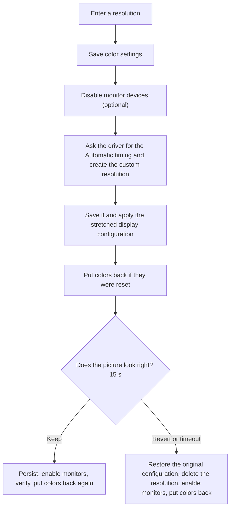

<p align="center"></p>

# NVIDIA Custom Resolution

> Stretched resolutions on NVIDIA GPUs without the Control Panel maze: no black bars, one confirmation, automatic rollback, and your brightness and color settings stay put.

**English** | [Русский](RREADME.md)

## What it is

NVIDIA Custom Resolution creates a custom resolution in the NVIDIA driver and stretches it to the full screen. It does in one step what normally takes a walk through NVIDIA Control Panel: create the resolution, test it, pick the right scaling mode, apply it and make it permanent.

It is made for people who play on stretched resolutions (for example 1280x960 or 900x573 on a 16:9 monitor in competitive shooters) and do not want to click through the same dialogs every time.

There are two front ends that share one engine:

| | GUI | Console |
| --- | --- | --- |
| File | `CustomRes.exe` | `true_stratched_val.bat` |
| Good for | everyday use | a single file you can carry anywhere |
| Language | English by default, EN / RU switch in the window | asks at start (Enter = English), or `/en` `/ru` |

## The problem it solves

A custom resolution with its own timing is sent to the monitor as is. The monitor then decides how to scale it, and most monitors keep the aspect ratio and add **black bars on the sides**. NVIDIA Control Panel avoids this with a custom resolution that is *scaled by the GPU*, but you have to know the right combination of timing standard, scaling mode and who does the scaling. With a second monitor the desktop layout often jumps around as well, and changing the mode can reset your brightness, contrast, gamma and digital vibrance.

## What you get

- **Real full-screen stretching.** The GPU does the scaling. The monitor keeps receiving its native timing and never sees the small resolution.
- **Only the primary display changes.** Other monitors keep their resolution, refresh rate and position.
- **Going back to the native resolution is safe.** If you enter the monitor's own resolution (for example 2560x1440), the program uses the timing the monitor itself reports instead of inventing one, and nothing custom is saved. A stale custom timing of exactly that size left in the driver is removed.
- **No out-of-range refresh rates.** In stretch mode a refresh rate above what the monitor lists for its native resolution is refused before anything changes.
- **Works with several displays on Windows 10/11.** Every display that was on stays on: the monitor devices are not disabled when more than one display is connected, and a display that Windows drops anyway is switched back on at its old place.
- **Your color settings are kept.** Brightness, contrast, gamma, digital vibrance (saturation) and hue are saved first and put back if the driver resets them.
- **One confirmation, automatic rollback.** If you do not confirm within 15 seconds, the original configuration comes back and the new resolution is deleted.
- **A log that explains itself.** Every step, every NVAPI error code and the signal that really goes to the monitor are printed.
- **Works with EDID-limited monitors.** While setting up, it can disable the monitor devices in Device Manager (the usual workaround when the driver refuses modes that are not in the monitor's EDID) and enables them again afterwards, also after errors and on Ctrl+C. With several displays connected this step is skipped, because it can switch the other displays off (see Windows 11 below).
- **English and Russian** in both versions.

## Quick start

**GUI**

1. Run `build.bat` once to produce `CustomRes.exe`. It uses the compiler that ships with Windows, so there is nothing to install. It compiles every `.cs` file in the folder.
2. Start `CustomRes.exe` and accept the UAC prompt.
3. Pick a preset (the first one is your original resolution) or enter width, height and refresh rate, keep **Stretch to the full screen** on and press **Create and apply**.
4. Look at the picture: **Keep** (Enter) or **Revert** (Esc).

The window opens in English. Use the **EN / RU** switch in the top-right corner to change the language; every caption updates immediately.

**Console**

Double-click `true_stratched_val.bat`, accept the UAC prompt, choose a language (Enter = English) and type a resolution such as `1280x960@240`.

## How it works

### The idea: who does the scaling

```
Own timing, 1:1 (the usual mistake)
  game 900x573 --> GPU --> signal 900x573 --> monitor scaler --> picture with side bars

This program (GPU scaling)
  game 900x573 --> GPU scaler --> native signal 2560x1440 --> monitor (nothing to scale) --> full screen
```

NVIDIA Control Panel creates custom resolutions with the **Automatic** timing as scalable modes: the timing stays native and only the source mode is new. This program does exactly that, then forces the scaling mode **Force GPU - Full Screen**, so the result does not depend on how your monitor scales.

### The sequence



1. **Preparation.** The primary display and its NVIDIA display id are found, and the untouched display configuration is remembered. **Brightness, contrast, gamma, digital vibrance and hue are saved** (see below). Optionally the monitor devices are disabled.
2. **Create.** The driver is asked for a timing (`Automatic`, then `Current`, `CVT-RB`, `CVT`, `GTF`). A timing larger than the requested size is the monitor's native timing and is used for the GPU-scaled mode. If none is accepted, the built-in CVT-RB timing is the last resort.
3. **Stretch.** The resolution is saved so that it appears in the driver's mode list, then a display configuration is applied: the new source mode, **Force GPU - Full Screen** scaling, and every other monitor moved so that it still touches the primary one on the same side with the same gap. The configuration is validated first.
4. **Check.** The configuration is read back and the log says whether the monitor receives the native resolution (the GPU scales) or the small one (the monitor scales and may add bars). The color settings are checked and restored if needed, so the test picture already has your colors.
5. **Confirm.** One question. No answer means rollback.
6. **Finish.** The configuration is persisted, the monitors are enabled again, and the result is verified once more. If something was reset, it is applied again. The color settings are checked a final time.

### Presets and your original resolution

The first preset in the window is **the resolution you started with** (for example 2560×1440), marked with a small red dot. The other presets are 1566×1080, 1440×993, 1350×931, 1280×880, 1280×815 and 1150×793. Choosing the first one also puts back the refresh rate you started with, so it is the quick way to return to the native mode (see below).

The original resolution is **remembered between runs** in `%ProgramData%\nv_custom_res_original.txt`. The first time (or when the graphics card or monitor changes) the program records the current resolution. If the desktop is already stretched by the GPU, it records the size of the signal that really goes to the monitor, which is the monitor's own size. Later runs keep the stored value even while the desktop is set to a stretched or custom mode. It is replaced only when the monitor's own size changes or the desktop is bigger than the stored one (a new monitor), and its refresh rate is refreshed whenever you run at that resolution. Delete the file to make the program forget it.

### Going back to the native resolution

To return, enter the monitor's own resolution (for example `2560x1440`) and its normal refresh rate. The driver's `Automatic` timing for that size has exactly the requested size: it is the timing the monitor itself reports. The program uses it as it is, applies it, and **does not create or save a custom resolution**. If an older run (or another tool) left a saved 1:1 custom timing of that very size and refresh rate in the driver, it is removed first, because the driver would offer it instead of the monitor's own one.

Two things could make "going back" produce noise, flicker and artifacts, and both are handled:

- **A custom timing at the native size.** Earlier versions only treated a mode as GPU-scaled when the driver's timing was larger than the request. For the native size it is not, so the program fell back to its own CVT-RB timing for 2560x1440 and saved it. That timing is not the one the monitor reports (blanking and pixel clock differ, especially at high refresh rates), and the driver then offered it in place of the native mode.
- **Monitors left disabled in Device Manager.** While the monitor devices are disabled, the driver does not check modes against the monitor's limits, so any refresh rate is accepted and sent. **Enable the monitors again afterwards** is now on by default, the program warns when monitors are still disabled from a previous run, and the refresh-rate check below runs before the monitors are disabled.

### Refresh-rate check

In stretch mode the picture is sent to the monitor at its native resolution, so the refresh rate you type is the refresh rate of that signal. Before anything is changed, the program looks up the highest refresh rate Windows lists for the monitor's native resolution. If you ask for more, it stops with a message and changes nothing. The console option `/force` skips this check (not recommended: the result can be a distorted picture).

### Windows 11 and several displays

Disabling a monitor in Device Manager is a workaround for monitors whose EDID does not list the mode. On Windows 10/11 a disabled monitor device can drop its display from the desktop, and after it is enabled again the display does not always come back. Earlier versions disabled **every** monitor device, so the second monitor could stay off after applying. Now:

- **Several displays connected: the monitor devices are left enabled** (the log says so). If the driver refuses the resolution, connect only one display and run again. The console option `/disableall` brings the old behaviour back (it can switch the other displays off).
- **All displays are checked.** The program remembers which displays are on, with their mode and place. After the stretched configuration is applied, after saving, after the monitors are enabled again and after a rollback it checks that all of them are still on. A missing display is switched on again with its old mode and placed against the edge of the primary display (same side, same gap). If that fails, the desktop is extended onto it, like Win+P > Extend.
- **Restore monitors** (and `/restore`) also extend the desktop onto a display that is connected but off.
- The first lines of the log show the Windows build and the number of displays, which helps when you report a problem.

### Brightness, contrast, gamma, saturation (color settings)

Changing the mode, applying a display configuration and switching monitor devices off and on can make the driver reset the desktop color settings. The program protects them:

| Setting (NVIDIA Control Panel name) | How it is read and written |
| --- | --- |
| Brightness, contrast, gamma | The display's gamma ramp (`GetDeviceGammaRamp` / `SetDeviceGammaRamp`) |
| Digital vibrance | NVAPI `GetDVCInfoEx` / `SetDVCLevelEx` (the older `GetDVCInfo` / `SetDVCLevel` as a fallback) |
| Hue | NVAPI `GetHUEInfo` / `SetHUEAngle` |

- Everything is **saved before the first change**, including before monitor devices are disabled.
- It is **checked again** just before the confirmation question, after the configuration is persisted, after the monitors are enabled again, and after a rollback.
- **Only what actually changed is written back.** If the driver did not reset anything, nothing is touched. The check is repeated a few times, because some drivers reset the values a moment later.
- The log tells you what happened: which settings were saved, which were put back, or `Color settings checked: nothing was reset.` If a setting cannot be read, it is simply not restored, and the log says so.
- To compare behaviour, the console version has `/nocolors`, which turns this off.

### Safety net

- The original display configuration is remembered before any change and is restored on rollback.
- A resolution that was saved for stretching is deleted if you do not keep it.
- Every display that was on at the start is checked after each risky step and switched on again at its old place if Windows dropped it.
- Disabled monitors are recorded in a small state file, so `/restore` (or the **Restore monitors** button) brings them back even after a crash. The GUI warns at start-up if monitors are still disabled from a previous run.
- Every failed step has a sensible fallback: if the display configuration is rejected, the mode is applied 1:1 and the log says so.

### Under the hood

| Part | Role |
| --- | --- |
| `customres_core.cs` | The engine: translations, CVT calculation, NVAPI and Windows display calls, color handling and the whole flow. It talks to the system through the `IPlatform` interface (and the optional `IColorPlatform`), so the logic can be tested without a GPU. |
| `customres_gui.cs` | The WinForms front end. All controls are drawn by the program and repaint themselves when their text changes. |
| `customres_icon.cs` | The application icon for the window. |
| `true_stratched_val.bat` | A PowerShell script with a copy of the engine after the `##PSSTART##` marker: it compiles it with `Add-Type` and uses it for the console dialog. |
| `app.manifest`, `app.ico`, `build.bat` | The administrator manifest, the application icon and the build script. `icon.png` is the same icon for this page. |

| Purpose | NVAPI call |
| --- | --- |
| Primary display id | `NvAPI_DISP_GetDisplayIdByDisplayName` |
| Timing from the driver | `NvAPI_DISP_GetTiming` |
| Create and test a resolution | `NvAPI_DISP_TryCustomDisplay` |
| Save, delete, list resolutions | `NvAPI_DISP_SaveCustomDisplay`, `NvAPI_DISP_DeleteCustomDisplay`, `NvAPI_DISP_EnumCustomDisplay` |
| End the trial mode | `NvAPI_DISP_RevertCustomDisplayTrial` |
| Source mode, scaling, positions | `NvAPI_DISP_GetDisplayConfig`, `NvAPI_DISP_SetDisplayConfig` |
| Display handle for color calls | `NvAPI_GetAssociatedNvidiaDisplayHandle`, `NvAPI_GetAssociatedDisplayOutputId` |
| Digital vibrance, hue | `NvAPI_GetDVCInfoEx`, `NvAPI_SetDVCLevelEx`, `NvAPI_GetDVCInfo`, `NvAPI_SetDVCLevel`, `NvAPI_GetHUEInfo`, `NvAPI_SetHUEAngle` |

On the Windows side: `EnumDisplayDevices`, `EnumDisplaySettings`, `ChangeDisplaySettingsEx`, `GetDeviceGammaRamp` / `SetDeviceGammaRamp`, and `Get/Disable/Enable-PnpDevice` for the monitor devices.

> **If you edit the engine:** the console script contains its own copy of `customres_core.cs`. After changing the engine, paste the new file between `$core = @'` and `'@` in `true_stratched_val.bat`, and rebuild the GUI with `build.bat`.

## Requirements

- Windows 10 or 11, 64-bit
- An NVIDIA GPU with the driver installed, with the **primary** display connected to it
- Administrator rights (both versions ask for them themselves)

## Console options of `true_stratched_val.bat`

| Option | Meaning |
| --- | --- |
| `/en`, `/ru` | Interface language, no question asked |
| `/restore` | Only re-enable the monitors disabled by a previous run |
| `/nodisable` | Do not disable the monitors (for troubleshooting) |
| `/nostretch` | Do not stretch: create a 1:1 mode and apply it through Windows |
| `/nocolors` | Do not save and restore brightness, contrast, gamma, vibrance and hue (for troubleshooting) |
| `/force` | Do not refuse a refresh rate above what the monitor lists for its native resolution (can distort the picture) |
| `/disableall` | Disable the monitor devices even when several displays are connected (can switch the other displays off) |

## Troubleshooting

- **Black bars on the sides.** Look for the `Signal to the monitor:` line in the log. If it shows the small resolution, the monitor is scaling: in NVIDIA Control Panel set **Adjust desktop size and position** > **Full-screen** and **Perform scaling on** > **GPU**, check the aspect setting in the monitor's own menu, and in the game tick **Override the scaling mode set by games and programs**.
- **A second monitor is off after applying (Windows 11).** Press Win+P and choose **Extend** (or Settings > System > Display > Multiple displays > **Extend these displays**). The **Restore monitors** button does the same when a display is connected but off. The program no longer disables monitor devices when several displays are connected, and it switches a dropped display back on by itself. If it still happens, attach the log.
- **Noise, flicker or artifacts after going back to the native resolution.**
  1. Press **Restore monitors** (or run `true_stratched_val.bat /restore`) so that the monitor devices are enabled again.
  2. Run the program, enter the native resolution and the monitor's normal refresh rate (for example `2560x1440` and 144 Hz). It uses the monitor's own timing and removes a stale custom timing of that size.
  3. If it is still broken, open NVIDIA Control Panel > **Change resolution** > **Customize**, delete the custom resolutions, then pick the native one in Windows display settings. Attach the log when you report it.
- **Brightness or saturation still changes.** Read the `Color settings` lines in the log. They show what was saved and what was put back. If a setting is reported as not restorable, set it again in NVIDIA Control Panel > **Adjust desktop color settings**, and attach the log when you report it. Running the console version with `/nocolors` shows what the driver does on its own.
- **`NVAPI_ERROR` on everything.** Run with `/nodisable` to see whether the disabled monitors are the cause, and attach the log when you report the problem.
- **Monitors stayed disabled.** `true_stratched_val.bat /restore` or the **Restore monitors** button.
- **Black screen during the test.** Wait: the automatic rollback brings the previous mode back.

## Status and disclaimer

Experimental. The NVIDIA display configuration part and the color settings part are new, and the NVAPI function ids come from the public table of the NvAPIWrapper project, because NVIDIA does not publish them. A very old or very new driver may not support them. If a step is rejected, the log says which one and with which code. Color handling is best effort and never stops the main flow.

Use at your own risk. Changing timings and scaling can leave the screen blank until the mode is rolled back, so try it somewhere a few seconds without a picture is not a problem.