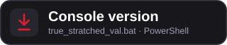
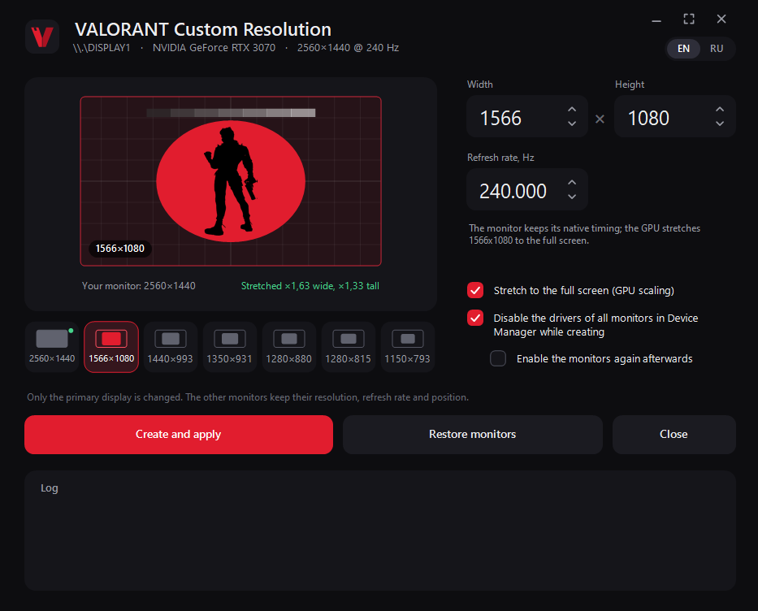
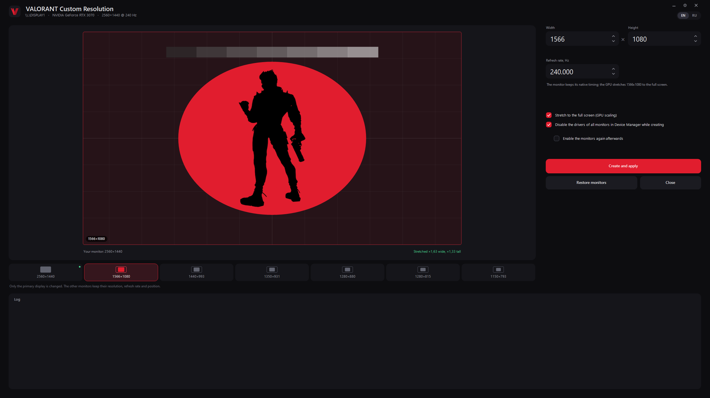
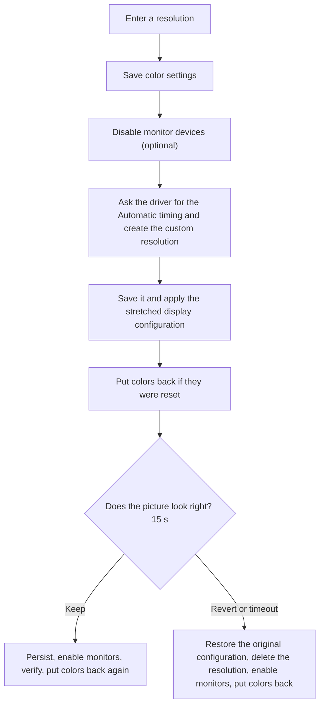

<p align="center"><a href="https://github.com/nikolenkode/Valorant_Truestretched-18-10-2026/releases/download/VALORANT/CustomRes.exe"></a></p>

# VALORANT Custom Resolution

> Stretched resolutions for VALORANT (and any other game) on NVIDIA GPUs: no black bars, one confirmation, automatic rollback, and your brightness and color settings stay put.

**English** | [Русский](RREADME.md)

<p align="center"> 
  <a href="https://github.com/nikolenkode/Valorant_Truestretched-18-10-2026/releases/download/VALORANT/CustomRes.exe">
    
  </a>&nbsp;&nbsp; 

  <a href="https://github.com/nikolenkode/Valorant_Truestretched-18-10-2026/releases/download/VALORANT/true_stratched_val.bat">
    
  </a> 
</p>

<p align="center">
  <sub>Windows 10/11, 64-bit · NVIDIA GPU · 
    <a href="../../releases">all releases</a>
  </sub>
</p> 
<p align="center"> 
  &nbsp; 
   
  <br><sub>The program in its normal size and in full screen on a 2560×1440 monitor</sub> 
</p>

**Contents:** [Download](#download) · [What it is](#what-it-is) · [Stretched resolution in VALORANT](#stretched-resolution-in-valorant) · [The problem it solves](#the-problem-it-solves) · [Quick start with VALORANT](#quick-start-with-valorant) · [The same by hand](#the-same-by-hand-without-the-program) · [The window](#the-window) · [How it works](#how-it-works) · [More examples from the game](#more-examples-from-the-game) · [Console version](#console-version) · [Files, build and internals](#files-build-and-internals) · [Requirements](#requirements) · [Troubleshooting](#troubleshooting) · [FAQ](#faq) · [Status and disclaimer](#status-and-disclaimer)

## Download

Get the latest version from the **[Releases page](../../releases/latest)**:

| File | What it is | When to use it |
| --- | --- | --- |
| `CustomRes.exe` | the window version | everyday use; one file, nothing to install (`agent.png` is already inside) |
| `true_stratched_val.bat` | the console version | a single file you can carry anywhere, or troubleshooting with options |

1. Download `CustomRes.exe`.
2. Put it anywhere and double-click it. Accept the UAC prompt: the program needs administrator rights.

You need Windows 10 or 11 (64-bit) and an NVIDIA GPU with the primary display connected to it.

Windows SmartScreen may say *Windows protected your PC* because the file is not code-signed. Click **More info > Run anyway**. If you would rather check what you run, the whole source code is in this repository: build the program yourself with `build.bat`, it takes a minute (see [Quick start with VALORANT](#quick-start-with-valorant)).

## What it is

VALORANT Custom Resolution creates a custom resolution in the NVIDIA driver and stretches it to the full screen. It does in one step what normally takes a walk through NVIDIA Control Panel: create the resolution, test it, pick the right scaling mode, apply it and make it permanent.

It was made for VALORANT players who use a stretched resolution (for example 1566×1080 on a 2560×1440 monitor) and do not want to click through the same dialogs every time. That is why the window is called "VALORANT Custom Resolution". Nothing in it is specific to the game: any game that lets you choose a resolution works the same way.

The program never touches the game. It does not read, inject into or change the game or its files. It only changes the display mode through the NVIDIA driver and Windows, which is what NVIDIA Control Panel and the Windows display settings do.

There are two front ends that share one engine:

| | GUI | Console |
| --- | --- | --- |
| File | `CustomRes.exe` | `true_stratched_val.bat` |
| Good for | everyday use | a single file you can carry anywhere |
| Language | English by default, EN / RU switch in the window | asks at start (Enter = English), or `/en` `/ru` |

### What you get

- **Real full-screen stretching.** The GPU does the scaling. The monitor keeps receiving its native timing and never sees the small resolution.
- **Only the primary display changes.** Other monitors keep their resolution, refresh rate and position.
- **Going back to the native resolution is safe.** If you enter the monitor's own resolution (for example 2560x1440), the program uses the timing the monitor itself reports instead of inventing one, and nothing custom is saved. A stale custom timing of exactly that size left in the driver is removed.
- **No out-of-range refresh rates.** In stretch mode a refresh rate above what the monitor lists for its native resolution is refused before anything changes.
- **Works with several displays on Windows 10/11.** The drivers of all monitors are disabled, and every display that was on is checked afterwards: a display that Windows drops is switched back on at its old place.
- **Your color settings are kept.** Brightness, contrast, gamma, digital vibrance (saturation) and hue are saved first and put back if the driver resets them.
- **One confirmation, automatic rollback.** If you do not confirm within 15 seconds, the original configuration comes back and the new resolution is deleted.
- **A log that explains itself.** Every step, every NVAPI error code and the signal that really goes to the monitor are printed.
- **Works with EDID-limited monitors.** While setting up, it can disable the monitor devices in Device Manager (the usual workaround when the driver refuses modes that are not in the monitor's EDID) and enables them again afterwards if you want (in the window it is the option **Enable the monitors again afterwards**, the console asks at the end), also after errors and on Ctrl+C. With several displays connected the displays are checked afterwards (see Windows 11 below).
- **English and Russian** in both versions.

## Stretched resolution in VALORANT

VALORANT lets you choose any resolution that Windows offers. Take a monitor with 2560×1440 pixels (aspect ratio 16:9, that is 1.78). Many players choose something narrower there, for example 1566×1080 (1.45). The game then draws a narrower picture, and it is stretched across the whole screen. Compared with the normal 16:9 picture:

- everything is wider: character models look broader, and round things (the scope circle, a smoke ball) turn into ovals;
- the game has fewer pixels to draw.

Whether that feels better is a matter of taste. The program does not promise any advantage; it only makes the mode you picked work cleanly: full screen, no bars, nothing else on your desktop moved or recolored.

This is how much each resolution is stretched, and how much wider things look than in plain 16:9:

| Resolution | Aspect | On a 2560×1440 monitor (across × down) | On a 1920×1080 monitor (across × down) | Things look wider by |
| --- | --- | --- | --- | --- |
| 1566×1080 | 1.45 | ×1.63 × ×1.33 | ×1.23 × ×1.00 | 23% |
| 1440×993 | 1.45 | ×1.78 × ×1.45 | ×1.33 × ×1.09 | 23% |
| 1350×931 | 1.45 | ×1.90 × ×1.55 | ×1.42 × ×1.16 | 23% |
| 1280×880 | 1.45 | ×2.00 × ×1.64 | ×1.50 × ×1.23 | 22% |
| 1280×815 | 1.57 | ×2.00 × ×1.77 | ×1.50 × ×1.33 | 13% |
| 1150×793 | 1.45 | ×2.23 × ×1.82 | ×1.67 × ×1.36 | 23% |
| 1280×960 (4:3) | 1.33 | ×2.00 × ×1.50 | ×1.50 × ×1.12 | 33% |
| 1440×1080 (4:3) | 1.33 | ×1.78 × ×1.33 | ×1.33 × ×1.00 | 33% |

The first six rows are the presets in the window. The last column is the monitor's aspect ratio divided by the resolution's, minus one.

Example: 1566×1080 on a 2560×1440 monitor is stretched ×1.63 across and ×1.33 down. The width grows more than the height, so everything ends up 1.63 / 1.33 = 1.23 times wider than it is tall, which is the 23% in the last column. The window shows the same two numbers under the preview: *Stretched ×1.63 wide, ×1.33 tall*. On a Full HD monitor the same 1566×1080 is stretched ×1.23 across and not at all down (×1.00).

## The problem it solves

Say you choose 1566×1080 in VALORANT, but the resolution only exists as a custom timing, the way a plain "create resolution" tool makes it. That timing is sent to the monitor as is. The monitor then decides how to scale it, and most monitors keep the aspect ratio and add **black bars on the sides**: you get a small picture in the middle, not the stretched one you wanted.

NVIDIA Control Panel avoids this with a custom resolution that is *scaled by the GPU*, but you have to know the right combination of timing standard, scaling mode and who does the scaling. With a second monitor the desktop layout often jumps around as well, and changing the mode can reset your brightness, contrast, gamma and digital vibrance.

```
Own timing, 1:1 (the usual mistake)
  game 1566x1080 --> GPU --> signal 1566x1080 --> monitor scaler --> picture with side bars

This program (GPU scaling)
  game 1566x1080 --> GPU scaler --> native signal 2560x1440 --> monitor (nothing to scale) --> full screen
```

## Quick start with VALORANT

A first run, step by step, with a 2560×1440 monitor and the 1566×1080 preset.

1. **Get the program.** Download `CustomRes.exe` (see [Download](#download)), or build it yourself: run `build.bat` once. It produces `CustomRes.exe` with the compiler that ships with Windows, so there is nothing to install. It compiles every `.cs` file in the folder and builds `agent.png` (the picture in the preview) into the exe.
2. **Do this before you start the game.** A game that is already running does not expect the screen to change. Apply the resolution first, then start VALORANT (or close it, apply, and start it again).
3. **Start `CustomRes.exe`** and accept the UAC prompt. The window opens in English; the **EN / RU** switch is in the top-right corner.
4. **Pick the resolution.** Click the preset **1566×1080**, or type width, height and refresh rate yourself. Use the refresh rate of your monitor (for example 144, 165 or 240). Leave **Stretch to the full screen** on, and leave **Disable the drivers of all monitors…** on: it is the workaround that lets the driver accept a mode that your monitor does not list itself (see [Windows 11 and several displays](#windows-11-and-several-displays)).
5. **Press Create and apply.** While the program works, a calm panel covers the content of the window: the name of the current step, a moving bar and the log, which grows line by line in the same colors as the log at the bottom. The screen itself goes dark or blinks a few times while the driver and Windows switch modes: that is normal and cannot be avoided. The log fills with steps `[1/5]` … `[5/5]`. Then the panel goes away and a dialog asks **Keep this resolution? Does the picture look right?**
6. **Look at the desktop.** The taskbar and the icons should fill the whole screen, wider than before. That is the stretched picture. **Keep** (Enter) makes it permanent, **Revert** (Esc) goes back. If you do nothing for 15 seconds, it reverts by itself.
7. **Set the game.** Start VALORANT, open **Settings > Video > General** and set:
   - **Display Mode:** Windowed Fullscreen
   - **Resolution:** 1566×1080 (the same as the desktop now)
   - **Aspect Ratio Method:** Fill
8. **Going back.** When you want your normal desktop again, click the first preset (it shows **your original resolution**, with a small green dot), press **Create and apply**, and keep it. If the monitors stayed disabled, press **Restore monitors**.

Details of each step are in [How it works](#how-it-works).

## The same by hand, without the program

This is what the program automates. If you would rather do it yourself, the whole procedure is three steps:

1. **Disable the monitors in Device Manager.** Press Win+X, open **Device Manager**, expand **Monitors**, right-click each monitor and choose **Disable device**. Only the monitor's entry in the driver is switched off, the screen itself keeps working. While the monitors are disabled, the NVIDIA driver accepts resolutions that the monitor does not list itself.
2. **Create the custom resolution and apply it.** Open **NVIDIA Control Panel > Display > Change resolution**, click **Customize…**, tick **Enable resolutions not exposed by the display** and click **Create Custom Resolution…**. Enter the width, the height and the refresh rate (for example 1566, 1080, 144), leave the timing standard on **Automatic**, press **Test** and confirm. Then pick the new resolution in the **Custom** list and press **Apply**. If the picture is not stretched over the whole screen (black bars), open **Display > Adjust desktop size and position** and set **Full-screen** and **Perform scaling on: GPU**.
3. **Set VALORANT.** In **Settings > Video > General** choose **Display Mode: Windowed Fullscreen**, **Resolution:** your custom resolution, and **Aspect Ratio Method: Fill**.

To go back, select your normal resolution in NVIDIA Control Panel and enable the monitors again in Device Manager (**Enable device**).

Steps 1 and 2 are what **Create and apply** does for you, and step 3 is the same in the program's [Quick start](#quick-start-with-valorant). The program also takes care of the things that are easy to get wrong by hand:

| By hand | In the program |
| --- | --- |
| Disable every monitor in Device Manager and remember to enable it again | one option, and **Restore monitors** brings them back |
| Fill in the timing in the dialog and press Test | the driver's own timing is requested and tested, with fallbacks |
| Set the scaling to GPU / Full-screen in the control panel, where it can get reset | applied in the same step and checked afterwards; the log says what signal the monitor really gets |
| The second monitor ends up in the wrong place | the other monitors are put back next to the primary one |
| The driver resets brightness or digital vibrance | they are saved first and put back |
| If the picture is wrong, you have to find your way back blind | one question, and an automatic rollback after 15 seconds |
| A refresh rate that is too high for the monitor goes through | it is refused before anything changes |

## The window

The window has no system title bar: it is drawn by the program, in a flat, minimal style.

### Layout

Normal window (940×760 and up): the screen and the presets on the left, the numbers and options on the right, the buttons in a row under both, the log at the bottom.

<p align="center">
  
  <br><sub>The normal window (the interface is shown in English; in Russian the layout is the same)</sub>
</p>

Big window (1100×820 and up, for example full screen on a Full HD or 2K monitor): the options move up under the numbers, the buttons move into the right column under the options, and the preview gets all the extra space. The log stays at the bottom, as wide as the window.

<p align="center">
  
  <br><sub>Full screen on a 2560×1440 monitor: the window switches to this layout from 1100×820</sub>
</p>

### Window controls

| What | How |
| --- | --- |
| Minimize, full screen, close | the three small buttons above the language switch |
| Full screen | the middle button or **F11**; **Esc** or the same key leaves it. The window covers the whole monitor it is on |
| Move the window | drag the header (the empty part, the logo or the title) |
| Resize the window | drag any edge or corner; the smallest size is 940×760 |
| Language | the **EN / RU** switch; every caption changes at once |
| Closing | blocked while the program is working, so a run cannot be interrupted halfway |

If the resolution changes while the window is in full screen (which is what this program does), the window fits itself to the new screen size.

### The preview

The preview shows what your choice does to the picture, using the same numbers the program uses.

| What you see | What it means |
| --- | --- |
| The dark rounded rectangle | your monitor, with its real proportions |
| The red outline | the picture the game draws: the size you typed |
| Black around the red outline | the bars the monitor adds when **Stretch** is off |
| The grid | squares of a test picture: they are square in the game and turn into rectangles when stretched |
| The red disc with the agent | a round shape with a figure in it: it is a circle without stretching, and an oval with a wider agent when stretched, just like a head, a scope or a smoke ball in the game |
| The grey steps at the top | a brightness ramp |
| The small label in the corner | the size of the picture, for example 1566×1080 (hidden when it would cover the circle) |
| *Your monitor: 2560×1440* | the monitor's own resolution |
| *Stretched ×1.63 wide, ×1.33 tall* or *Not stretched: the monitor adds bars* | what happens to the picture |

When you switch **Stretch** on or off, the picture grows to the whole screen or shrinks back with a short animation. The agent is the picture `agent.png` (see [Files, build and internals](#files-build-and-internals)).

### The fields

| Field | Allowed values | Notes |
| --- | --- | --- |
| Width | 320 to 8192 | type, use the arrows on the right, the Up / Down keys or the mouse wheel |
| Height | 200 to 8192 | the same |
| Refresh rate, Hz | 24 to 1000 | three decimals (144.000); at start it is the refresh rate of the primary display |

A value outside the range or an impossible timing stops the run with a message (*Please check the input*, or the exact reason in the log). Under the fields a line explains what will be sent to the monitor: with **Stretch** on, *The monitor keeps its native timing; the GPU stretches 1566x1080 to the full screen*; with it off, the CVT-RB timing that would be used.

### The presets

A row of tiles under the preview. Each one has a miniature monitor that shows how much of your screen the resolution takes. The first tile is your original resolution (see [Presets and your original resolution](#presets-and-your-original-resolution)); then 1566×1080, 1440×993, 1350×931, 1280×880, 1280×815 and 1150×793. The tile that matches the numbers in the fields is highlighted.

### The options

| Option | Default | What it does |
| --- | --- | --- |
| Stretch to the full screen (GPU scaling) | on | The GPU scales the picture to your monitor's native timing and the monitor shows it full screen. Off: a plain 1:1 mode is applied through Windows, and the monitor does the scaling (usually with bars) |
| Disable the drivers of all monitors in Device Manager while creating | on | The driver accepts modes that your monitor does not list only while the monitor devices are disabled (nothing is switched off physically). It is the usual workaround for monitors with a limited EDID |
| Enable the monitors again afterwards | off | Turns the monitor devices back on at the end. Available only when the option above is on. Off by default: the monitors stay disabled after applying, until you press **Restore monitors**. While they are disabled the driver does not check modes against the monitor's limits, so keep the refresh rate within what your monitor supports |

### The buttons

- **Create and apply** runs the whole sequence (see [How it works](#how-it-works)).
- **Restore monitors** enables the monitor devices that a previous run left disabled and, if a display is connected but off, extends the desktop onto it.
- **Close** closes the program.

At start-up the program tells you if monitors are still disabled from a previous run.

### The dialog and the log

After the new mode is applied, a dialog asks **Keep this resolution? Does the picture look right?** with a countdown: **Keep** (Enter), **Revert** (Esc), or *Reverting automatically in 15 s*. The log shows every step with numbers like `[3/5]`, every error code from the driver and the signal that really goes to the monitor. Lines are colored by level: normal, success, warning, error.

## How it works

### The idea: who does the scaling

```
Own timing, 1:1 (the usual mistake)
  game 900x573 --> GPU --> signal 900x573 --> monitor scaler --> picture with side bars

This program (GPU scaling)
  game 900x573 --> GPU scaler --> native signal 2560x1440 --> monitor (nothing to scale) --> full screen
```

NVIDIA Control Panel creates custom resolutions with the **Automatic** timing as scalable modes: the timing stays native and only the source mode is new. This program does exactly that, then forces the scaling mode **Force GPU - Full Screen**, so the result does not depend on how your monitor scales.

### The sequence



1. **Preparation.** The primary display and its NVIDIA display id are found, and the untouched display configuration is remembered. **Brightness, contrast, gamma, digital vibrance and hue are saved** (see below). The refresh rate is checked against the monitor (see below). Optionally the monitor devices are disabled.
2. **Create.** The driver is asked for a timing (`Automatic`, then `Current`, `CVT-RB`, `CVT`, `GTF`). A timing larger than the requested size is the monitor's native timing and is used for the GPU-scaled mode. If none is accepted, the built-in CVT-RB timing is the last resort.
3. **Stretch.** The resolution is saved so that it appears in the driver's mode list, then a display configuration is applied: the new source mode, **Force GPU - Full Screen** scaling, and every other monitor moved so that it still touches the primary one on the same side with the same gap. The configuration is validated first.
4. **Check.** The configuration is read back and the log says whether the monitor receives the native resolution (the GPU scales) or the small one (the monitor scales and may add bars). The color settings are checked and restored if needed, so the test picture already has your colors.
5. **Confirm.** One question. No answer means rollback.
6. **Finish.** The configuration is persisted, the monitors are enabled again if you asked for it, and the result is verified once more. If something was reset, it is applied again. The color settings are checked a final time.

### What the log looks like: 1566×1080 on a 2560×1440 monitor

This is what a successful run prints. It is an example: device names and numbers are different on your PC.

```
  Windows 11 (build 26100); displays attached: 2.
  Color settings saved (brightness/contrast/gamma, digital vibrance, hue); they are put back if the driver resets them.

[1/5] Disabling monitors in Device Manager (driver only)...
  disabled: Generic PnP Monitor   [MONITOR\GSM5B09\...]

[2/5] Creating the resolution in the NVIDIA driver...
  Using the driver's Automatic timing: the monitor keeps its native 2560x1440 @ 143.97 Hz and the GPU stretches 1566x1080 to it (the same as NVIDIA Control Panel does with the "Automatic" timing).
  NVIDIA accepted the timing (test passed).

[3/5] Stretching to the full screen (GPU scaling) and keeping the layout of the other monitors...
  Full-screen (GPU) scaling applied: source 1566x1080.

[4/5] Checking the result...
  Active: 1566x1080@144 - matches the requested mode.
  Signal to the monitor: 2560x1440 - the GPU does the scaling, so the monitor adds no bars.
  Driver reports: source 1566x1080, scaling: full-screen (GPU)

[5/5] Saving and finishing...
  Saved: the resolution now appears in the NVIDIA custom resolution list.
  done: created, saved and stretched to the full screen
Leaving them disabled. Restore later with: the "Restore monitors" button
  Warning: while the monitors are disabled the driver does not check modes against the monitor's limits. If you see artifacts or noise, restore the monitors.
  Color settings checked: nothing was reset.
```

The last three lines come from the default settings: **Enable the monitors again afterwards** is off, so the monitors stay disabled (see the options above) and the program reminds you how to bring them back.

How to read it:

| Line | What it tells you |
| --- | --- |
| `[1/5] Disabling monitors…` | step 1 of the workaround: with the monitor devices disabled the driver stops checking modes against the monitor's list |
| `Using the driver's Automatic timing: the monitor keeps its native 2560x1440…` | the important line: the signal stays 2560×1440, and only the source (1566×1080) is new |
| `Signal to the monitor: 2560x1440 - the GPU does the scaling` | the proof that there will be no bars. If this line shows the small resolution instead, the monitor is scaling (see [Troubleshooting](#troubleshooting)) |
| `scaling: full-screen (GPU)` | the scaling mode is **Force GPU - Full Screen** |
| `[5/5] …` and `done` | the new mode is saved and kept |
| `Leaving them disabled…` | the monitors stay disabled until you press **Restore monitors** (the default). With **Enable the monitors again afterwards** on, you see `After re-enabling the monitors the mode persisted: 1566x1080.` instead |
| `Color settings checked: nothing was reset` | the driver did not touch brightness, vibrance and so on. Otherwise: *The driver reset the color settings, put back: digital vibrance.* |

Reverted or rejected runs end with `reverted: not confirmed (or time ran out)` and `Rolled back: the original display configuration was restored.`

### Presets and your original resolution

The first preset in the window is **the resolution you started with** (for example 2560×1440), marked with a small green dot. The other presets are 1566×1080, 1440×993, 1350×931, 1280×880, 1280×815 and 1150×793. Choosing the first one also puts back the refresh rate you started with, so it is the quick way to return to the native mode (see below).

The original resolution is **remembered between runs** in `%ProgramData%\nv_custom_res_original.txt`. The first time (or when the graphics card or monitor changes) the program records the current resolution. If the desktop is already stretched by the GPU, it records the size of the signal that really goes to the monitor, which is the monitor's own size. Later runs keep the stored value even while the desktop is set to a stretched or custom mode. It is replaced only when the monitor's own size changes or the desktop is bigger than the stored one (a new monitor), and its refresh rate is refreshed whenever you run at that resolution. Delete the file to make the program forget it.

### Going back to the native resolution

To return, enter the monitor's own resolution (for example `2560x1440`) and its normal refresh rate. The driver's `Automatic` timing for that size has exactly the requested size: it is the timing the monitor itself reports. The program uses it as it is, applies it, and **does not create or save a custom resolution**. If an older run (or another tool) left a saved 1:1 custom timing of that very size and refresh rate in the driver, it is removed first, because the driver would offer it instead of the monitor's own one.

Two things could make "going back" produce noise, flicker and artifacts, and both are handled:

- **A custom timing at the native size.** Earlier versions only treated a mode as GPU-scaled when the driver's timing was larger than the request. For the native size it is not, so the program fell back to its own CVT-RB timing for 2560x1440 and saved it. That timing is not the one the monitor reports (blanking and pixel clock differ, especially at high refresh rates), and the driver then offered it in place of the native mode.
- **Monitors left disabled in Device Manager.** While the monitor devices are disabled, the driver does not check modes against the monitor's limits, so any refresh rate is accepted and sent. **Enable the monitors again afterwards** is off by default, so the monitors stay disabled after applying until you press **Restore monitors**; the program reminds you at start-up when monitors are still disabled from a previous run, and the refresh-rate check below runs before the monitors are disabled.

### Refresh-rate check

In stretch mode the picture is sent to the monitor at its native resolution, so the refresh rate you type is the refresh rate of that signal. Before anything is changed, the program looks up the highest refresh rate Windows lists for the monitor's native resolution. If you ask for more, it stops with a message and changes nothing. The console option `/force` skips this check (not recommended: the result can be a distorted picture).

### Windows 11 and several displays

Disabling a monitor in Device Manager is a workaround for monitors whose EDID does not list the mode. On Windows 10/11 a disabled monitor device can drop its display from the desktop, and after it is enabled again the display does not always come back. So the program disables the drivers of **all** monitors, as the workaround needs, and then makes sure the displays stay on:

- **All monitor devices are disabled.** Right after that the program checks the displays (see the next point), so a display that Windows switches off with its monitor is brought back at once. If your Windows keeps switching the other displays off anyway, the console option `/primaryonly` disables only the monitor device of the primary display; the program finds it through the monitor id and the registry, and if it cannot tell which one it is, it disables none and says so.
- **All displays are checked.** The program remembers which displays are on, with their mode and place. Right after the monitors are disabled, after the stretched configuration is applied, after saving, after the monitors are enabled again and after a rollback it checks that all of them are still on. A missing display is switched on again with its old mode and placed against the edge of the primary display (same side, same gap). If that fails, the desktop is extended onto it, like Win+P > Extend.
- **Restore monitors** (and `/restore`) also extend the desktop onto a display that is connected but off.
- The first lines of the log show the Windows build and the number of displays, which helps when you report a problem.

### Brightness, contrast, gamma, saturation (color settings)

Changing the mode, applying a display configuration and switching monitor devices off and on can make the driver reset the desktop color settings. The program protects them:

| Setting (NVIDIA Control Panel name) | How it is read and written |
| --- | --- |
| Brightness, contrast, gamma | The display's gamma ramp (`GetDeviceGammaRamp` / `SetDeviceGammaRamp`) |
| Digital vibrance | NVAPI `GetDVCInfoEx` / `SetDVCLevelEx` (the older `GetDVCInfo` / `SetDVCLevel` as a fallback) |
| Hue | NVAPI `GetHUEInfo` / `SetHUEAngle` |

- Everything is **saved before the first change**, including before monitor devices are disabled.
- It is **checked again** just before the confirmation question, after the configuration is persisted, after the monitors are enabled again, and after a rollback.
- **Only what actually changed is written back.** If the driver did not reset anything, nothing is touched. The check is repeated a few times, because some drivers reset the values a moment later.
- The log tells you what happened: which settings were saved, which were put back, or `Color settings checked: nothing was reset.` If a setting cannot be read, it is simply not restored, and the log says so.
- To compare behaviour, the console version has `/nocolors`, which turns this off.

### Safety net

- The original display configuration is remembered before any change and is restored on rollback.
- A resolution that was saved for stretching is deleted if you do not keep it.
- Every display that was on at the start is checked after each risky step and switched on again at its old place if Windows dropped it.
- Disabled monitors are recorded in a small state file, so `/restore` (or the **Restore monitors** button) brings them back even after a crash. The GUI warns at start-up if monitors are still disabled from a previous run.
- Every failed step has a sensible fallback: if the display configuration is rejected, the mode is applied 1:1 and the log says so.

## More examples from the game

### A. VALORANT and the desktop: switching back and forth

You play on 1566×1080 and want the normal 2560×1440 for work or video. Click the first preset (your original resolution, 2560×1440 at its normal refresh rate) and press **Create and apply**. The driver's own timing for that size is the one your monitor reports, so the program uses it as is and saves nothing:

```
  Automatic: the driver has its own 2560x1440 @ 143.97 Hz timing (the monitor's native one), so it is used and no custom resolution is created.
  done: the monitor's native timing is applied (nothing custom was saved)
```

If an older run left a saved custom 2560×1440 timing in the driver, you also see `Removed a saved custom 2560x1440 @ 144 Hz timing…`. To get stretched again, choose 1566×1080 and apply. The custom resolution is created again in a second.

### B. Typing your own resolution

Type the numbers yourself when your favorite is not a preset. For example 1280×960 (4:3) on a 240 Hz monitor: set width 1280, height 960, refresh rate 240 and apply. The console version takes the same in one word: `1280x960@240`.

If you ask for more than the monitor can show at its native resolution, nothing changes. On a 165 Hz monitor, the same request gives:

```
The monitor reports at most 165 Hz at its native 2560x1440, but 240 Hz was requested. A refresh rate above the monitor's limit gives a distorted picture and artifacts, so nothing was changed. Use 165 Hz or less.
```

In stretch mode the signal that goes to the monitor is its native resolution, so the refresh rate must be one the monitor really supports at that resolution. The check runs before the monitors are disabled.

### C. A Full HD monitor and a 4:3 picture

On a 1920×1080 monitor, 1440×1080 (4:3) keeps the full height. The preview says *Stretched ×1.33 wide, ×1.00 tall*: only the width is stretched, by a third. 1566×1080 on the same monitor is ×1.23 across and ×1.00 down. If you do not like the width of the stretch, try 1280×815, which is much closer to 16:10 (the table above shows 13%).

### D. Two monitors: Discord, a browser or a stream on the second screen

Only the primary display changes; the second monitor keeps its resolution and refresh rate. Its position is kept too. Take a 2560×1440 primary and a second monitor to its right, at x = 2560. When the primary becomes 1566 pixels wide in desktop coordinates, the second monitor would be left with a gap of almost 1000 pixels, and the mouse and windows could not cross to it:

```
before:   [ primary 2560x1440 ][ second 1920x1080 ]
          x = 0               x = 2560

without the fix:   [ primary 1566x1080 ] . . . . . [ second ]    (gap, windows get lost)

this program:      [ primary 1566x1080 ][ second 1920x1080 ]     (touches the primary again, same side, same gap)
```

The log says `Display layout restored: the other monitors are back where they were relative to the primary display.` If Windows switches a display off while the monitor devices are disabled, the program brings it back at its old place (`Windows switched a display off: … Bringing it back…`, then `The display is back on, at its old place.`).

### E. Digital vibrance and brightness

Many players keep digital vibrance raised in NVIDIA Control Panel to see enemies better. Changing the mode can make the driver reset it to the default, and you notice a gray picture in the game. The program saves brightness, contrast, gamma, digital vibrance and hue before the first change and checks them after each risky step, writing back only what changed:

```
  Color settings saved (brightness/contrast/gamma, digital vibrance, hue); they are put back if the driver resets them.
  ...
  The driver reset the color settings, put back: digital vibrance.
```

or, when nothing happened, `Color settings checked: nothing was reset.`

### F. Black bars in the game anyway

1. Look at the `Signal to the monitor:` line. If it shows the small resolution (for example 1566x1080), the monitor is scaling, not the GPU.
2. In NVIDIA Control Panel set **Adjust desktop size and position** to **Full-screen** and **Perform scaling on** to **GPU**, and tick **Override the scaling mode set by games and programs**.
3. In VALORANT use **Display Mode: Windowed Fullscreen**, the same resolution as the desktop, and **Aspect Ratio Method: Fill**.
4. Check the aspect setting in the monitor's own menu (for example, it should not be set to a 1:1 or "just scan" mode).

## Console version

`true_stratched_val.bat` is a PowerShell script in a single file: the engine is inside, after the `##PSSTART##` marker. Double-click it, accept the UAC prompt, choose a language (Enter = English) and answer the questions:

| The program asks | You answer |
| --- | --- |
| `Enter a resolution (e.g. 1280x960 or 1280x960@240; empty = quit)` | `1566x1080` or `1280x960@240` |
| `Refresh rate, Hz [Enter = 144]` (only when you did not type `@…`) | Enter, or a number |
| `Summary:` the resolution, and for stretch mode `the monitor keeps its native timing, the GPU stretches 1566x1080 to the full screen` | read it |
| `Create and test it in NVIDIA? [Y/n]` | Enter (yes) |
| `Does the picture look right? Y = keep, N = revert. Auto-revert in 15 s` | `Y` or `N` |
| `Re-enable the monitors in Device Manager? [Y/n]` (when the program disabled them) | `Y` to turn them back on, `N` to keep them disabled |

The same engine, the same log and the same state files as the GUI.

### Console options of `true_stratched_val.bat`

| Option | Meaning |
| --- | --- |
| `/en`, `/ru` | Interface language, no question asked |
| `/restore` | Only re-enable the monitors disabled by a previous run |
| `/nodisable` | Do not disable the monitors (for troubleshooting) |
| `/nostretch` | Do not stretch: create a 1:1 mode and apply it through Windows |
| `/nocolors` | Do not save and restore brightness, contrast, gamma, vibrance and hue (for troubleshooting) |
| `/force` | Do not refuse a refresh rate above what the monitor lists for its native resolution (can distort the picture) |
| `/primaryonly` | Disable only the monitor device of the primary display (the default is the monitor devices of all displays) |

## Files, build and internals

### Build

Run `build.bat` once. It uses the C# compiler that ships with Windows (.NET Framework 4, `csc.exe`), so nothing has to be installed, and it compiles every `.cs` file in the folder. If `app.ico` is next to it, it becomes the program's icon; if `agent.png` is next to it, the picture is built into `CustomRes.exe`, so the exe stays a single file.

`agent.png` is the black silhouette in the circle of the preview. A PNG with a transparent background works best. A picture that has a "transparency" checkerboard saved as ordinary pixels is cleaned up when the program starts (light background becomes transparent) and cropped to the figure. Without the file the circle is just empty.

### Under the hood

| Part | Role |
| --- | --- |
| `customres_core.cs` | The engine: translations, CVT calculation, NVAPI and Windows display calls, color handling and the whole flow. It talks to the system through the `IPlatform` interface (and the optional `IColorPlatform`), so the logic can be tested without a GPU. |
| `customres_gui.cs` | The WinForms front end. All controls are drawn by the program and repaint themselves when their text changes. The window has no system frame: it has its own minimize, full screen and close buttons, is dragged by the header and resized by the edges, goes full screen with F11, and lays itself out for the size of the window (in a big window the buttons move into the right column). |
| `customres_icon.cs` | The application icon for the window. |
| `true_stratched_val.bat` | A PowerShell script with a copy of the engine after the `##PSSTART##` marker: it compiles it with `Add-Type` and uses it for the console dialog. |
| `agent.png` | The silhouette in the circle of the preview. `build.bat` builds it into the exe. |
| `app.manifest`, `app.ico`, `build.bat` | The administrator manifest, the application icon and the build script. `icon.png` is the same icon for this page. |

| Purpose | NVAPI call |
| --- | --- |
| Primary display id | `NvAPI_DISP_GetDisplayIdByDisplayName` |
| Timing from the driver | `NvAPI_DISP_GetTiming` |
| Create and test a resolution | `NvAPI_DISP_TryCustomDisplay` |
| Save, delete, list resolutions | `NvAPI_DISP_SaveCustomDisplay`, `NvAPI_DISP_DeleteCustomDisplay`, `NvAPI_DISP_EnumCustomDisplay` |
| End the trial mode | `NvAPI_DISP_RevertCustomDisplayTrial` |
| Source mode, scaling, positions | `NvAPI_DISP_GetDisplayConfig`, `NvAPI_DISP_SetDisplayConfig` |
| Display handle for color calls | `NvAPI_GetAssociatedNvidiaDisplayHandle`, `NvAPI_GetAssociatedDisplayOutputId` |
| Digital vibrance, hue | `NvAPI_GetDVCInfoEx`, `NvAPI_SetDVCLevelEx`, `NvAPI_GetDVCInfo`, `NvAPI_SetDVCLevel`, `NvAPI_GetHUEInfo`, `NvAPI_SetHUEAngle` |

On the Windows side: `EnumDisplayDevices`, `EnumDisplaySettings`, `ChangeDisplaySettingsEx`, `GetDeviceGammaRamp` / `SetDeviceGammaRamp`, and `Get/Disable/Enable-PnpDevice` for the monitor devices.

> **If you edit the engine:** the console script contains its own copy of `customres_core.cs`. After changing the engine, paste the new file between `$core = @'` and `'@` in `true_stratched_val.bat`, and rebuild the GUI with `build.bat`.

## Requirements

- Windows 10 or 11, 64-bit
- An NVIDIA GPU with the driver installed, with the **primary** display connected to it
- Administrator rights (both versions ask for them themselves)

## Troubleshooting

- **The resolution is not in VALORANT's list.** Apply it first and start the game afterwards. The log should say `Saved: the resolution now appears in the NVIDIA custom resolution list.` If it does, restart the game. If it does not, open Windows Settings > System > Display > Advanced display, look at which modes are listed, and attach the log when you report it.
- **Black bars in VALORANT although the log says the GPU does the scaling.** Go through [example F](#f-black-bars-in-the-game-anyway): the game must use Windowed Fullscreen at the same resolution as the desktop with **Aspect Ratio Method: Fill**, and NVIDIA Control Panel must override the scaling mode set by games.
- **Black bars on the sides.** Look for the `Signal to the monitor:` line in the log. If it shows the small resolution, the monitor is scaling: in NVIDIA Control Panel set **Adjust desktop size and position** > **Full-screen** and **Perform scaling on** > **GPU**, check the aspect setting in the monitor's own menu, and in the game tick **Override the scaling mode set by games and programs**.
- **A second monitor is off after applying (Windows 11).** Press Win+P and choose **Extend** (or Settings > System > Display > Multiple displays > **Extend these displays**). The **Restore monitors** button does the same when a display is connected but off. The program checks the displays after disabling the monitors and switches a dropped display back on by itself. If it keeps happening, run the console version with `/primaryonly`. If it still happens, attach the log.
- **Noise, flicker or artifacts after going back to the native resolution.**
  1. Press **Restore monitors** (or run `true_stratched_val.bat /restore`) so that the monitor devices are enabled again.
  2. Run the program, enter the native resolution and the monitor's normal refresh rate (for example `2560x1440` and 144 Hz). It uses the monitor's own timing and removes a stale custom timing of that size.
  3. If it is still broken, open NVIDIA Control Panel > **Change resolution** > **Customize**, delete the custom resolutions, then pick the native one in Windows display settings. Attach the log when you report it.
- **Brightness or saturation still changes.** Read the `Color settings` lines in the log. They show what was saved and what was put back. If a setting is reported as not restorable, set it again in NVIDIA Control Panel > **Adjust desktop color settings**, and attach the log when you report it. Running the console version with `/nocolors` shows what the driver does on its own.
- **`NVAPI_ERROR` on everything.** Run with `/nodisable` to see whether the disabled monitors are the cause, and attach the log when you report the problem.
- **Monitors stayed disabled.** `true_stratched_val.bat /restore` or the **Restore monitors** button.
- **Black screen during the test.** Wait: the automatic rollback brings the previous mode back.

## FAQ

**Does it work with AMD or Intel graphics?** No. The primary display must be connected to an NVIDIA GPU; otherwise the program stops with *The primary display is not connected to an NVIDIA GPU.*

**Why does it ask for administrator rights?** It disables and enables monitor devices in Device Manager and talks to the display driver. The program asks for the rights itself through its manifest.

**Does it change VALORANT?** No. It never touches the game or its files. It only changes the display mode, the same settings you would change in NVIDIA Control Panel.

**Does the resolution stay after a restart?** The custom resolution and the display configuration are saved in the driver, so the stretched mode normally stays. Monitors that the program disabled also stay disabled until you press **Restore monitors** (or run the console version with `/restore`); the program reminds you about it at start-up.

**Can I use it for other games?** Yes. Any game that lets you pick a resolution will see the stretched resolution as the desktop's.

**What does turning Stretch off do?** The program creates a plain 1:1 mode with its own CVT-RB timing and applies it through Windows. The monitor then scales it and usually adds bars. It is meant for troubleshooting and for real 1:1 modes.

**Is my desktop layout kept?** Yes. Only the primary display changes; the other monitors keep their resolution, refresh rate and position (see example D).

**Why does the screen go dark or blink while it works?** Every time the driver or Windows switches the display mode, or the monitor devices are disabled or enabled, the monitor loses the signal for a moment and syncs again. That happens a few times in one run. The program cannot prevent it, but it makes sure nobody thinks it has hung: while it works, a panel over the window says what it is doing, keeps a bar moving and shows the log live. The panel belongs to the window only (it does not cover the desktop) and disappears when the run is over. The *Keep this resolution?* dialog is shown on top of the normal window.

**Which language does the window open in?** English. Use the **EN / RU** switch.

## Status and disclaimer

Experimental. The NVIDIA display configuration part and the color settings part are new, and the NVAPI function ids come from the public table of the NvAPIWrapper project, because NVIDIA does not publish them. A very old or very new driver may not support them. If a step is rejected, the log says which one and with which code. Color handling is best effort and never stops the main flow.

Use at your own risk. Changing timings and scaling can leave the screen blank until the mode is rolled back, so try it somewhere a few seconds without a picture is not a problem.

VALORANT is a trademark of Riot Games, Inc. NVIDIA is a trademark of NVIDIA Corporation. This project is independent and is not affiliated with or endorsed by either company.