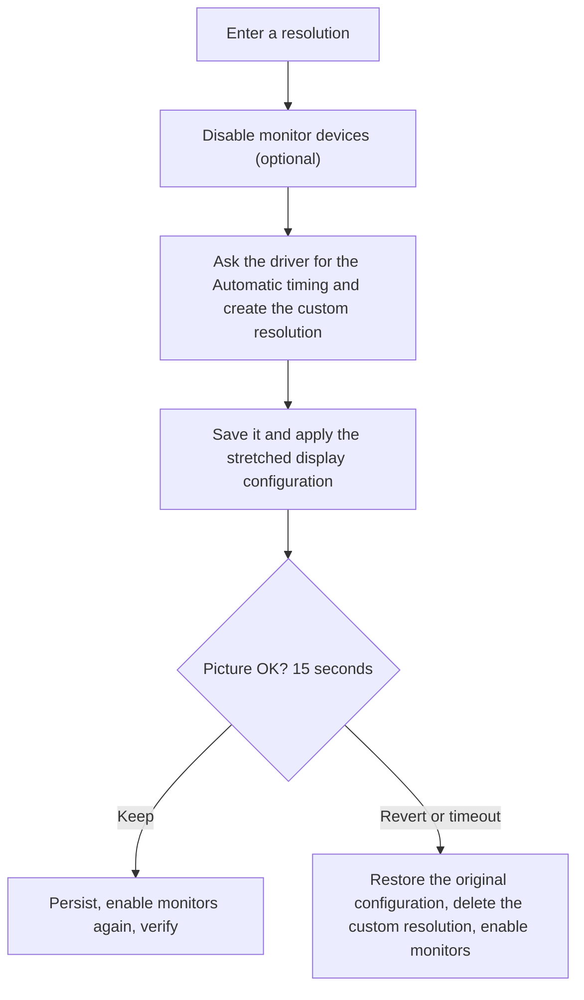

# NVIDIA Custom Resolution

> Stretched resolutions on NVIDIA GPUs without the Control Panel maze: no black bars, one confirmation, automatic rollback.

**English** | [Русский](RREADME.md)

## What is it

NVIDIA Custom Resolution creates a custom resolution in the NVIDIA driver and stretches it to the full screen. It does in one step what normally takes a trip through NVIDIA Control Panel: create the resolution, test it, pick the right scaling mode, apply it, and make it stick.

It is made for people who play with stretched resolutions (for example 1280x960 or 900x573 on a 16:9 monitor in a competitive shooter) and do not want to click through the same dialogs every time.

It comes in two forms that share one engine:

| | Graphical version | Console version |
| --- | --- | --- |
| File | `CustomRes.exe` | `true_stratched_val.bat` |
| Good for | everyday use | a single file you can copy anywhere |
| Language | English / Русский, switch in the window | English / Русский, `/en` `/ru` |

## The problem it solves

A custom resolution made with its own timing is sent to the monitor as is. The monitor then decides how to scale it, and most monitors keep the aspect ratio and add **black bars on the sides**. Control Panel avoids that with a *GPU-scaled* custom resolution, but you have to know the right combination of timing standard, scaling mode and scaling device, and with a second monitor connected the desktop layout often jumps around as well.

## What you get

- **A real full-screen stretch.** The GPU does the scaling, the monitor keeps receiving its native timing and never sees the small resolution.
- **Only the primary display is touched.** The other monitors keep their resolution, refresh rate and position.
- **One confirmation, automatic rollback.** If you do not confirm within 15 seconds, the original configuration comes back and the new resolution is deleted.
- **A log that explains itself.** Every step, every NVAPI error code and the signal that actually goes to the monitor are printed.
- **Safe with monitor tricks.** It can disable the monitor devices in Device Manager for the time of the setup (the usual workaround for the driver refusing resolutions that the monitor's EDID does not list) and puts them back, also after errors and Ctrl+C.
- **English and Russian** in both versions.

## Quick start

**Graphical version**

1. Run `build.bat` once to get `CustomRes.exe` (it uses the compiler that ships with Windows, nothing to install, and compiles every `.cs` file in the folder).
2. Start `CustomRes.exe` and approve the UAC prompt.
3. Pick a preset or enter width, height and refresh rate, leave **Stretch to the full screen** on and press **Create and apply**.
4. Look at the picture: **Keep** (Enter) or **Revert** (Esc).

**Console version**

Double-click `true_stratched_val.bat`, approve the UAC prompt, choose the language and type a resolution such as `1280x960@240`.

## How it works

### The idea: who does the scaling

```
Custom timing, 1:1 (the common mistake)
  game 900x573 --> GPU --> 900x573 signal --> monitor scaler --> picture with bars on the sides

This tool (GPU scaling)
  game 900x573 --> GPU scaler --> 2560x1440 native signal --> monitor (nothing to scale) --> full screen
```

NVIDIA Control Panel creates its custom resolutions with the **Automatic** timing as scaled modes: the timing stays native and only the source mode is new. This tool does exactly that and then forces the scaling mode **Force GPU - Full Screen**, so the result does not depend on how your monitor scales.

### The flow



1. **Prepare.** The primary display and its NVIDIA display ID are found, and the untouched display configuration is remembered. Optionally the monitor devices are disabled.
2. **Create.** The driver is asked for a timing (`Automatic`, then `Current`, `CVT-RB`, `CVT`, `GTF`). A timing larger than the request is the monitor's native timing and is used for a GPU-scaled mode. If none of them is accepted, a built-in CVT-RB timing is the last resort.
3. **Stretch.** The resolution is saved so that it appears in the driver's mode list, then the display configuration is applied: new source mode, scaling **Force GPU - Full Screen**, and the other monitors moved so that they still touch the primary one on the same side with the same gap. The configuration is validated first.
4. **Check.** The configuration is read back, and the log says whether the monitor receives its native resolution (the GPU scales) or the small one (the monitor scales and may add bars).
5. **Confirm.** One question. No answer means rollback.
6. **Finish.** The configuration is persisted, the monitors are enabled again and the result is verified once more. If something was reset, it is applied again.

### The safety net

- The original display configuration is captured before anything changes and is restored on rollback.
- A resolution saved for the stretch is deleted again if you do not keep it.
- The monitors that were disabled are remembered in a small state file, so `/restore` (or **Restore monitors**) can bring them back even after a crash.
- Every failing step falls back to something sensible: if the display configuration is rejected, the mode is applied 1:1 and the log says so.

### Under the hood

| Part | Role |
| --- | --- |
| `customres_core.cs` | The engine: translations, CVT timing, NVAPI and Windows display calls, the whole flow. It talks to the system through an `IPlatform` interface, so the logic can be exercised without a GPU. |
| `customres_gui.cs` | WinForms front end. |
| `true_stratched_val.bat` | A PowerShell script that carries a copy of the engine after the `##PSSTART##` marker, compiles it with `Add-Type` and uses it for the console dialog. |
| `app.manifest`, `build.bat` | Administrator manifest and the build script. |

| Purpose | NVAPI call |
| --- | --- |
| Display ID of the primary display | `NvAPI_DISP_GetDisplayIdByDisplayName` |
| Timing from the driver | `NvAPI_DISP_GetTiming` |
| Create / test the resolution | `NvAPI_DISP_TryCustomDisplay` |
| Save / delete / list resolutions | `NvAPI_DISP_SaveCustomDisplay`, `NvAPI_DISP_DeleteCustomDisplay`, `NvAPI_DISP_EnumCustomDisplay` |
| End the trial | `NvAPI_DISP_RevertCustomDisplayTrial` |
| Source mode, scaling, positions | `NvAPI_DISP_GetDisplayConfig`, `NvAPI_DISP_SetDisplayConfig` |

Windows side: `EnumDisplayDevices`, `EnumDisplaySettings`, `ChangeDisplaySettingsEx`, and `Get/Disable/Enable-PnpDevice` for the monitor devices.

## Requirements

- Windows 10 or 11, 64-bit
- NVIDIA GPU with an installed driver, with the **primary** display connected to it
- Administrator rights (both versions ask for them)

## Command line options of `true_stratched_val.bat`

| Option | Meaning |
| --- | --- |
| `/en`, `/ru` | Interface language, no question is asked |
| `/restore` | Only enable the monitors that a previous run disabled |
| `/nodisable` | Do not disable the monitors (for troubleshooting) |
| `/nostretch` | Do not stretch: create a 1:1 mode and apply it through Windows |

## Troubleshooting

- **Black bars on the sides.** Look at the line `Signal to the monitor:` in the log. If it shows the small resolution, the monitor does the scaling: in NVIDIA Control Panel set **Adjust desktop size and position** to **Full-screen** and **Perform scaling on** to **GPU**, check the aspect option in the monitor's menu, and in a game tick **Override the scaling mode set by games and programs**.
- **`NVAPI_ERROR` for everything.** Run with `/nodisable` to see whether the disabled monitors are the cause, and attach the log when you report an issue.
- **Monitors stay disabled.** `true_stratched_val.bat /restore` or the **Restore monitors** button.
- **Black screen during a test.** Wait: the automatic rollback restores the previous mode.

## Status and disclaimer

Experimental. The NVIDIA display configuration part is new, and NVAPI function IDs are taken from the public NvAPIWrapper table because NVIDIA does not publish them; a very old or very new driver may not expose them. When a step is rejected, the log shows which one and with which code.

Use at your own risk. Changing timings and scaling can leave a display showing nothing until the mode is rolled back, so try it where losing the picture for a few seconds is fine.