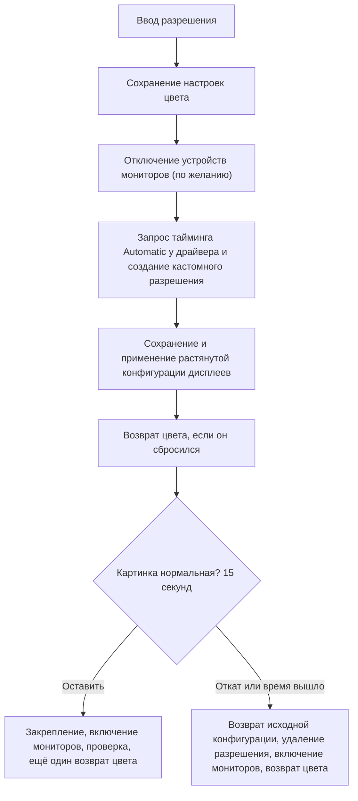

<p align="center"></p>

# NVIDIA Custom Resolution

> Растянутые разрешения на видеокартах NVIDIA без лабиринта панели управления: без чёрных полос, с одним подтверждением, автоматическим откатом и с сохранёнными настройками яркости и цвета.

[English](README.md) | **Русский**

## Что это

NVIDIA Custom Resolution создаёт кастомное разрешение в драйвере NVIDIA и растягивает его на весь экран. Он делает за один шаг то, что обычно требует прогулки по панели управления NVIDIA: создать разрешение, протестировать, выбрать правильный режим масштабирования, применить и закрепить.

Он сделан для тех, кто играет на растянутых разрешениях (например 1280x960 или 900x573 на мониторе 16:9 в соревновательных шутерах) и не хочет каждый раз кликать по одним и тем же окнам.

Есть две формы, у которых один общий движок:

| | Графическая версия | Консольная версия |
| --- | --- | --- |
| Файл | `CustomRes.exe` | `true_stratched_val.bat` |
| Подходит для | ежедневного использования | одного файла, который можно унести куда угодно |
| Язык | по умолчанию English, переключатель EN / RU в окне | спрашивает при запуске (Enter = English), либо `/en` `/ru` |

## Какую проблему он решает

Кастомное разрешение с собственным таймингом уходит на монитор как есть. Дальше монитор сам решает, как его масштабировать, и большинство мониторов сохраняют пропорции и добавляют **чёрные полосы по бокам**. Панель NVIDIA обходит это через кастомное разрешение с *масштабированием на видеокарте*, но нужно знать правильное сочетание стандарта тайминга, режима масштабирования и того, кто масштабирует. При втором мониторе расположение рабочего стола часто «прыгает», а смена режима может сбросить яркость, контрастность, гамму и цифровую насыщенность.

## Что вы получаете

- **Настоящее растягивание на весь экран.** Масштабирует видеокарта, монитор продолжает получать родной тайминг и маленького разрешения вообще не видит.
- **Меняется только основной дисплей.** Остальные мониторы сохраняют разрешение, частоту и расположение.
- **Настройки цвета сохраняются.** Яркость, контрастность, гамма, цифровая насыщенность (Digital Vibrance) и оттенок запоминаются заранее и возвращаются, если драйвер их сбросит.
- **Одно подтверждение и автоматический откат.** Если за 15 секунд вы не подтвердили, возвращается исходная конфигурация, а новое разрешение удаляется.
- **Журнал, который сам всё объясняет.** Печатаются каждый шаг, каждый код ошибки NVAPI и сигнал, который реально уходит на монитор.
- **Совместимость с мониторами, у которых ограниченный EDID.** На время настройки он может отключить устройства мониторов в диспетчере устройств (обычный обходной путь, если драйвер отказывается от разрешений, которых нет в EDID монитора) и возвращает их обратно, в том числе после ошибок и по Ctrl+C.
- **Английский и русский** в обеих версиях.

## Быстрый старт

**Графическая версия**

1. Один раз запустите `build.bat`, чтобы получить `CustomRes.exe` (он использует компилятор из состава Windows, ничего ставить не нужно, и собирает все `.cs` файлы из папки).
2. Запустите `CustomRes.exe` и подтвердите запрос UAC.
3. Выберите готовый вариант или введите ширину, высоту и частоту, оставьте включённым **Растянуть на весь экран** и нажмите **Создать и применить**.
4. Посмотрите на картинку: **Оставить** (Enter) или **Откатить** (Esc).

Окно открывается на английском. Переключатель **EN / RU** в правом верхнем углу меняет язык, все подписи обновляются сразу.

**Консольная версия**

Запустите `true_stratched_val.bat` двойным кликом, подтвердите запрос UAC, выберите язык (Enter = English) и введите разрешение, например `1280x960@240`.

## Как это работает

### Идея: кто масштабирует

```
Собственный тайминг 1:1 (типичная ошибка)
  игра 900x573 --> GPU --> сигнал 900x573 --> скейлер монитора --> картинка с полосами по бокам

Эта программа (масштабирование на видеокарте)
  игра 900x573 --> скейлер GPU --> родной сигнал 2560x1440 --> монитор (масштабировать нечего) --> весь экран
```

Панель NVIDIA создаёт свои кастомные разрешения с таймингом **Automatic** как масштабируемые режимы: тайминг остаётся родным, новым становится только исходный режим. Программа делает ровно это, а затем принудительно включает режим масштабирования **Force GPU - Full Screen**, чтобы результат не зависел от того, как масштабирует ваш монитор.

### Последовательность



1. **Подготовка.** Находится основной дисплей и его идентификатор в NVIDIA, запоминается нетронутая конфигурация дисплеев. **Сохраняются яркость, контрастность, гамма, цифровая насыщенность и оттенок** (подробнее ниже). По желанию отключаются устройства мониторов.
2. **Создание.** У драйвера запрашивается тайминг (`Automatic`, затем `Current`, `CVT-RB`, `CVT`, `GTF`). Тайминг больше запрошенного размера это родной тайминг монитора, он используется для режима с масштабированием на GPU. Если ни один не принят, последним вариантом остаётся встроенный CVT-RB.
3. **Растягивание.** Разрешение сохраняется, чтобы попасть в список режимов драйвера, затем применяется конфигурация дисплеев: новый исходный режим, масштабирование **Force GPU - Full Screen**, а остальные мониторы сдвигаются так, чтобы по-прежнему касаться основного с той же стороны и с тем же зазором. Сначала конфигурация проверяется.
4. **Проверка.** Конфигурация читается обратно, и в логе написано, получает ли монитор родное разрешение (масштабирует GPU) или маленькое (масштабирует монитор и может добавить полосы). Настройки цвета проверяются и при необходимости возвращаются, так что тестовая картинка уже с вашими цветами.
5. **Подтверждение.** Один вопрос. Нет ответа значит откат.
6. **Завершение.** Конфигурация закрепляется, мониторы включаются обратно, результат проверяется ещё раз. Если что-то сбросилось, оно применяется заново. Настройки цвета проверяются в последний раз.

### Яркость, контрастность, гамма, насыщенность (настройки цвета)

Смена режима, применение конфигурации дисплеев и отключение с включением устройств мониторов могут заставить драйвер сбросить цветовые настройки рабочего стола. Программа их защищает:

| Настройка (как в панели NVIDIA) | Как читается и записывается |
| --- | --- |
| Яркость, контрастность, гамма | Гамма-рампа дисплея (`GetDeviceGammaRamp` / `SetDeviceGammaRamp`) |
| Цифровая насыщенность (Digital vibrance) | NVAPI `GetDVCInfoEx` / `SetDVCLevelEx` (старые `GetDVCInfo` / `SetDVCLevel` как запасной вариант) |
| Оттенок | NVAPI `GetHUEInfo` / `SetHUEAngle` |

- Всё **сохраняется до первого изменения**, в том числе до отключения устройств мониторов.
- **Проверка повторяется** прямо перед вопросом о подтверждении, после закрепления конфигурации, после включения мониторов и после отката.
- **Записывается обратно только то, что действительно изменилось.** Если драйвер ничего не сбросил, ничего не трогается. Проверка повторяется несколько раз, потому что некоторые драйверы сбрасывают значения чуть позже.
- В логе видно, что произошло: что сохранено, что возвращено, либо строка `Настройки цвета проверены: ничего не сбросилось.` Если какую-то настройку прочитать не удалось, она просто не восстанавливается, и об этом сказано в логе.
- Чтобы сравнить поведение, в консольной версии есть `/nocolors`, который это выключает.

### Страховка

- Исходная конфигурация дисплеев запоминается до любых изменений и восстанавливается при откате.
- Разрешение, сохранённое для растягивания, удаляется, если вы его не оставили.
- Отключённые мониторы записываются в небольшой файл состояния, поэтому `/restore` (или кнопка **Вернуть мониторы**) вернёт их даже после сбоя.
- Каждый неудавшийся шаг имеет разумный запасной вариант: если конфигурация дисплеев отклонена, режим применяется 1:1, и об этом сказано в логе.

### Устройство изнутри

| Часть | Роль |
| --- | --- |
| `customres_core.cs` | Движок: переводы, расчёт CVT, вызовы NVAPI и Windows для дисплеев, работа с цветом и весь сценарий. Общается с системой через интерфейс `IPlatform` (и необязательный `IColorPlatform`), поэтому логику можно проверять без видеокарты. |
| `customres_gui.cs` | Интерфейс на WinForms. Все элементы рисуются самой программой и перерисовываются при смене текста. |
| `customres_icon.cs` | Иконка приложения для окна. |
| `true_stratched_val.bat` | Скрипт PowerShell с копией движка после маркера `##PSSTART##`: компилирует его через `Add-Type` и использует для консольного диалога. |
| `app.manifest`, `app.ico`, `build.bat` | Манифест администратора, иконка приложения и скрипт сборки. `icon.png` это та же иконка для этой страницы. |

| Назначение | Вызов NVAPI |
| --- | --- |
| Идентификатор основного дисплея | `NvAPI_DISP_GetDisplayIdByDisplayName` |
| Тайминг от драйвера | `NvAPI_DISP_GetTiming` |
| Создание и тест разрешения | `NvAPI_DISP_TryCustomDisplay` |
| Сохранение, удаление, список разрешений | `NvAPI_DISP_SaveCustomDisplay`, `NvAPI_DISP_DeleteCustomDisplay`, `NvAPI_DISP_EnumCustomDisplay` |
| Завершение пробного режима | `NvAPI_DISP_RevertCustomDisplayTrial` |
| Исходный режим, масштабирование, положения | `NvAPI_DISP_GetDisplayConfig`, `NvAPI_DISP_SetDisplayConfig` |
| Дескриптор дисплея для цветовых вызовов | `NvAPI_GetAssociatedNvidiaDisplayHandle`, `NvAPI_GetAssociatedDisplayOutputId` |
| Цифровая насыщенность, оттенок | `NvAPI_GetDVCInfoEx`, `NvAPI_SetDVCLevelEx`, `NvAPI_GetDVCInfo`, `NvAPI_SetDVCLevel`, `NvAPI_GetHUEInfo`, `NvAPI_SetHUEAngle` |

Со стороны Windows: `EnumDisplayDevices`, `EnumDisplaySettings`, `ChangeDisplaySettingsEx`, `GetDeviceGammaRamp` / `SetDeviceGammaRamp` и `Get/Disable/Enable-PnpDevice` для устройств мониторов.

> **Если вы правите движок:** в консольном скрипте лежит собственная копия `customres_core.cs`. После изменения движка вставьте новый файл между `$core = @'` и `'@` в `true_stratched_val.bat` и пересоберите графическую версию через `build.bat`.

## Требования

- Windows 10 или 11, 64-бит
- Видеокарта NVIDIA с установленным драйвером, к которой подключён **основной** дисплей
- Права администратора (обе версии запросят их сами)

## Параметры командной строки `true_stratched_val.bat`

| Параметр | Значение |
| --- | --- |
| `/en`, `/ru` | Язык интерфейса, вопрос не задаётся |
| `/restore` | Только включить мониторы, отключённые прошлым запуском |
| `/nodisable` | Не отключать мониторы (для диагностики) |
| `/nostretch` | Не растягивать: создать режим 1:1 и применить его через Windows |
| `/nocolors` | Не сохранять и не восстанавливать яркость, контрастность, гамму, насыщенность и оттенок (для диагностики) |

## Если не получается

- **Чёрные полосы по бокам.** Посмотрите в логе строку `Сигнал на монитор:`. Если там маленькое разрешение, масштабирует монитор: в панели NVIDIA выставьте **Регулировка размера и положения рабочего стола** > **Во весь экран** и **Масштабирование выполняется на** > **GPU**, проверьте параметр формата в меню монитора, а в игре поставьте галочку **Заменить режим масштабирования, заданный для игр и программ**.
- **Яркость или насыщенность всё равно меняются.** Прочитайте в логе строки про настройки цвета: там видно, что сохранено и что возвращено. Если настройку вернуть не удалось, выставьте её заново в панели NVIDIA > **Регулировка параметров цвета рабочего стола** и приложите лог, когда будете сообщать о проблеме. Запуск консольной версии с `/nocolors` покажет, что драйвер делает сам.
- **`NVAPI_ERROR` на всё.** Запустите с `/nodisable`, чтобы понять, виноваты ли отключённые мониторы, и приложите лог, когда будете сообщать о проблеме.
- **Мониторы остались отключёнными.** `true_stratched_val.bat /restore` или кнопка **Вернуть мониторы**.
- **Чёрный экран во время теста.** Подождите: автоматический откат вернёт прежний режим.

## Статус и отказ от ответственности

Экспериментальная версия. Часть с конфигурацией дисплеев NVIDIA и часть с настройками цвета новые, а ID функций NVAPI взяты из публичной таблицы проекта NvAPIWrapper, потому что NVIDIA их не публикует; очень старый или очень новый драйвер может их не поддерживать. Если шаг отклонён, в логе указано, какой именно и с каким кодом. Работа с цветом выполняется по возможности и никогда не останавливает основной сценарий.

Используйте на свой страх и риск. Изменение таймингов и масштабирования может привести к тому, что экран ничего не покажет, пока режим не откатится, поэтому пробуйте там, где потеря картинки на несколько секунд не страшна.