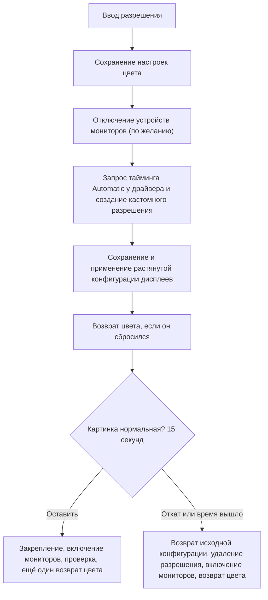

<p align="center"></p>

# NVIDIA Custom Resolution

> Растянутые разрешения для VALORANT (и любой другой игры) на видеокартах NVIDIA: без чёрных полос, с одним подтверждением, автоматическим откатом и с сохранёнными настройками яркости и цвета.

[English](README.md) | **Русский**

<p align="center">
  <a href="../../releases/latest"></a>
  <a href="../../releases/latest"></a>
</p>

**Содержание:** [Скачать](#скачать) · [Что это](#что-это) · [Растянутое разрешение в VALORANT](#растянутое-разрешение-в-valorant) · [Какую проблему он решает](#какую-проблему-он-решает) · [Быстрый старт с VALORANT](#быстрый-старт-с-valorant) · [Окно программы](#окно-программы) · [Как это работает](#как-это-работает) · [Ещё примеры из игры](#ещё-примеры-из-игры) · [Консольная версия](#консольная-версия) · [Файлы, сборка и устройство](#файлы-сборка-и-устройство) · [Требования](#требования) · [Если не получается](#если-не-получается) · [Вопросы и ответы](#вопросы-и-ответы) · [Статус и отказ от ответственности](#статус-и-отказ-от-ответственности)

## Скачать

Последнюю версию берите на странице **[Releases](../../releases/latest)**:

| Файл | Что это | Когда нужен |
| --- | --- | --- |
| `CustomRes.exe` | версия с окном | ежедневное использование; один файл, ничего ставить не нужно (`agent.png` уже внутри) |
| `true_stratched_val.bat` | консольная версия | один файл, который можно унести куда угодно, или диагностика с параметрами |

1. Скачайте `CustomRes.exe`.
2. Положите куда угодно и запустите двойным кликом. Подтвердите запрос UAC: программе нужны права администратора.

Нужны Windows 10 или 11 (64-бит) и видеокарта NVIDIA, к которой подключён основной дисплей.

Windows SmartScreen может показать *Windows защитила ваш компьютер*, потому что у файла нет цифровой подписи. Нажмите **Подробнее > Выполнить в любом случае**. Если хотите проверить, что запускаете, весь исходный код лежит в этом репозитории: соберите программу сами через `build.bat`, это минута (см. [Быстрый старт с VALORANT](#быстрый-старт-с-valorant)).

## Что это

NVIDIA Custom Resolution создаёт кастомное разрешение в драйвере NVIDIA и растягивает его на весь экран. Он делает за один шаг то, что обычно требует прогулки по панели управления NVIDIA: создать разрешение, протестировать, выбрать правильный режим масштабирования, применить и закрепить.

Он сделан для игроков в VALORANT, которые играют на растянутом разрешении (например 1566×1080 на мониторе 2560×1440) и не хотят каждый раз кликать по одним и тем же окнам. Поэтому окно называется «VALORANT Custom Resolution». Ничего в нём не привязано к игре: любая игра, в которой можно выбрать разрешение в полноэкранном режиме, работает так же.

Программа не трогает игру. Она не читает игру, не внедряется в неё и не меняет её файлы. Она только меняет режим дисплея через драйвер NVIDIA и Windows, то есть делает то же, что панель управления NVIDIA и параметры дисплея Windows.

Есть две формы, у которых один общий движок:

| | Графическая версия | Консольная версия |
| --- | --- | --- |
| Файл | `CustomRes.exe` | `true_stratched_val.bat` |
| Подходит для | ежедневного использования | одного файла, который можно унести куда угодно |
| Язык | по умолчанию English, переключатель EN / RU в окне | спрашивает при запуске (Enter = English), либо `/en` `/ru` |

### Что вы получаете

- **Настоящее растягивание на весь экран.** Масштабирует видеокарта, монитор продолжает получать родной тайминг и маленького разрешения вообще не видит.
- **Меняется только основной дисплей.** Остальные мониторы сохраняют разрешение, частоту и расположение.
- **Возврат на родное разрешение безопасен.** Если ввести собственное разрешение монитора (например 2560x1440), программа использует тайминг, который сообщает сам монитор, а не придумывает свой, и ничего кастомного не сохраняется. Оставшийся в драйвере старый кастомный тайминг ровно такого размера удаляется.
- **Нет частот вне допустимого диапазона.** В режиме растягивания частота выше той, что монитор заявляет для своего родного разрешения, отклоняется до любых изменений.
- **Работает с несколькими дисплеями в Windows 10/11.** Драйверы всех мониторов отключаются, а потом проверяются все дисплеи, которые были включены: дисплей, который Windows выключила, возвращается на прежнее место.
- **Настройки цвета сохраняются.** Яркость, контрастность, гамма, цифровая насыщенность (Digital Vibrance) и оттенок запоминаются заранее и возвращаются, если драйвер их сбросит.
- **Одно подтверждение и автоматический откат.** Если за 15 секунд вы не подтвердили, возвращается исходная конфигурация, а новое разрешение удаляется.
- **Журнал, который сам всё объясняет.** Печатаются каждый шаг, каждый код ошибки NVAPI и сигнал, который реально уходит на монитор.
- **Совместимость с мониторами, у которых ограниченный EDID.** На время настройки он может отключить устройства мониторов в диспетчере устройств (обычный обходной путь, если драйвер отказывается от разрешений, которых нет в EDID монитора) и по желанию возвращает их обратно (в окне это параметр **Включить мониторы обратно после применения**, консоль спрашивает в конце), в том числе после ошибок и по Ctrl+C. Если подключено несколько дисплеев, после этого проверяются все дисплеи (см. Windows 11 ниже).
- **Английский и русский** в обеих версиях.

## Растянутое разрешение в VALORANT

VALORANT позволяет выбрать любое разрешение, которое предлагает Windows. Возьмём монитор 2560×1440 пикселей (пропорции 16:9, то есть 1,78). Многие игроки выбирают там что-то уже, например 1566×1080 (1,45). Игра рисует более узкую картинку, и она растягивается на весь экран. По сравнению с обычной картинкой 16:9:

- всё становится шире: модели персонажей выглядят крупнее в ширину, а круглые вещи (круг прицела, шар дыма) превращаются в овалы;
- игре нужно рисовать меньше пикселей.

Лучше от этого или нет, дело вкуса. Программа не обещает никаких преимуществ, она только делает так, чтобы выбранный режим работал чисто: во весь экран, без полос, и ничего на рабочем столе не сдвигалось и не меняло цвет.

Вот насколько растягивается каждое разрешение и насколько шире всё выглядит, чем в обычном 16:9:

| Разрешение | Пропорции | На мониторе 2560×1440 (по ширине × по высоте) | На мониторе 1920×1080 (по ширине × по высоте) | Всё выглядит шире на |
| --- | --- | --- | --- | --- |
| 1566×1080 | 1,45 | ×1,63 × ×1,33 | ×1,23 × ×1,00 | 23% |
| 1440×993 | 1,45 | ×1,78 × ×1,45 | ×1,33 × ×1,09 | 23% |
| 1350×931 | 1,45 | ×1,90 × ×1,55 | ×1,42 × ×1,16 | 23% |
| 1280×880 | 1,45 | ×2,00 × ×1,64 | ×1,50 × ×1,23 | 22% |
| 1280×815 | 1,57 | ×2,00 × ×1,77 | ×1,50 × ×1,33 | 13% |
| 1150×793 | 1,45 | ×2,23 × ×1,82 | ×1,67 × ×1,36 | 23% |
| 1280×960 (4:3) | 1,33 | ×2,00 × ×1,50 | ×1,50 × ×1,12 | 33% |
| 1440×1080 (4:3) | 1,33 | ×1,78 × ×1,33 | ×1,33 × ×1,00 | 33% |

Первые шесть строк это готовые варианты в окне. Последний столбец это пропорции монитора, делённые на пропорции разрешения, минус единица.

Пример: 1566×1080 на мониторе 2560×1440 растягивается ×1,63 по ширине и ×1,33 по высоте. Ширина растёт сильнее высоты, поэтому всё становится в 1,63 / 1,33 = 1,23 раза шире относительно высоты, это и есть 23% в последнем столбце. Окно показывает те же два числа под превью: *Растянуто ×1,63 по ширине, ×1,33 по высоте*. На мониторе Full HD то же 1566×1080 растягивается ×1,23 по ширине и совсем не растягивается по высоте (×1,00).

## Какую проблему он решает

Допустим, вы выбираете в VALORANT 1566×1080, но такое разрешение существует только как кастомный тайминг, как его делает обычная утилита «создать разрешение». Этот тайминг уходит на монитор как есть. Дальше монитор сам решает, как его масштабировать, и большинство мониторов сохраняют пропорции и добавляют **чёрные полосы по бокам**: вы получаете маленькую картинку посередине, а не растянутую, как хотели.

Панель NVIDIA обходит это через кастомное разрешение с *масштабированием на видеокарте*, но нужно знать правильное сочетание стандарта тайминга, режима масштабирования и того, кто масштабирует. При втором мониторе расположение рабочего стола часто «прыгает», а смена режима может сбросить яркость, контрастность, гамму и цифровую насыщенность.

```
Собственный тайминг 1:1 (типичная ошибка)
  игра 1566x1080 --> GPU --> сигнал 1566x1080 --> скейлер монитора --> картинка с полосами по бокам

Эта программа (масштабирование на видеокарте)
  игра 1566x1080 --> скейлер GPU --> родной сигнал 2560x1440 --> монитор (масштабировать нечего) --> весь экран
```

## Быстрый старт с VALORANT

Первый запуск шаг за шагом, для монитора 2560×1440 и варианта 1566×1080.

1. **Получите программу.** Скачайте `CustomRes.exe` (см. [Скачать](#скачать)) или соберите сами: один раз запустите `build.bat`. Он создаст `CustomRes.exe` компилятором из состава Windows, ничего ставить не нужно. Он собирает все `.cs` файлы из папки и вшивает в exe `agent.png` (картинку в превью).
2. **Сделайте это до запуска игры.** Игра, которая уже запущена, не ждёт, что экран изменится. Сначала примените разрешение, потом запускайте VALORANT (или закройте игру, примените и запустите снова).
3. **Запустите `CustomRes.exe`** и подтвердите запрос UAC. Окно открывается на английском, переключатель **EN / RU** в правом верхнем углу.
4. **Выберите разрешение.** Нажмите готовый вариант **1566×1080** или введите ширину, высоту и частоту сами. Частоту ставьте ту, что у вашего монитора (например 144, 165 или 240). Оставьте включённым **Растянуть на весь экран** и **Отключить драйверы всех мониторов…**: это обходной путь, благодаря которому драйвер принимает режим, которого нет в списке самого монитора (см. [Windows 11 и несколько дисплеев](#windows-11-и-несколько-дисплеев)).
5. **Нажмите «Создать и применить».** Экран на миг гаснет, в журнале появляются шаги `[1/5]` … `[5/5]`, а потом диалог спрашивает **Оставить это разрешение? Картинка нормальная?**
6. **Посмотрите на рабочий стол.** Панель задач и значки должны занимать весь экран и быть шире, чем раньше. Это и есть растянутая картинка. **Оставить** (Enter) закрепляет её, **Откатить** (Esc) возвращает всё назад. Если ничего не нажимать 15 секунд, откат произойдёт сам.
7. **Настройте игру.** Запустите VALORANT, откройте **Settings > Video > General** (Настройки > Видео > Общие) и выберите:
   - **Режим отображения** (Display Mode): полноэкранный (Fullscreen)
   - **Разрешение** (Resolution): 1566×1080 (такое же, как у рабочего стола сейчас)
   - **Метод соотношения сторон** (Aspect Ratio Method): Fill (заполнение), если в вашей версии игры есть такая настройка
8. **Возврат.** Когда захотите обычный рабочий стол, нажмите первый вариант (в нём **ваше исходное разрешение**, он отмечен маленькой зелёной точкой), нажмите «Создать и применить» и оставьте. Если мониторы остались отключёнными, нажмите «Вернуть мониторы».

Подробности по каждому шагу в разделе [Как это работает](#как-это-работает).

## Окно программы

У окна нет системной заголовочной строки: оно нарисовано самой программой, в плоском минималистичном стиле.

### Расположение

Обычное окно (940×760 и больше): слева экран и готовые варианты, справа числа и параметры, под ними кнопки в один ряд, внизу журнал.

```
+----------------------------------------------------------------------+
| (V) VALORANT Custom Resolution                       [_]  [ ]  [x]   |
|     Основной дисплей: ...                                 [EN | RU]  |
|                                                                      |
|  +---------------------------+      Ширина          Высота           |
|  |  превью вашего экрана:    |      [ 1566 ]   x    [ 1080 ]         |
|  |  монитор, картинка, круг  |      Частота, Гц                      |
|  +---------------------------+      [ 144.000 ]                      |
|  [исх.][1566x1080][1440x993]...     Монитор остаётся на родном ...    |
|  Меняется только основной ...       [x] Растянуть на весь экран       |
|                                     [x] Отключить драйверы всех ...   |
|                                         [ ] Включить мониторы ...     |
|  [ Создать и применить ] [ Вернуть мониторы ] [ Закрыть ]            |
|  +-- Журнал ----------------------------------------------------+    |
|  |                                                               |    |
|  +---------------------------------------------------------------+    |
+----------------------------------------------------------------------+
```

Большое окно (1100×820 и больше, например полный экран на мониторе Full HD или 2K): параметры поднимаются под числа, кнопки переезжают в правую колонку под параметры, а превью получает всё свободное место. Журнал остаётся внизу и занимает всю ширину окна.

```
+------------------------------------------------------------------------------------+
| (V) VALORANT Custom Resolution                                      [_]  [ ]  [x]  |
|                                                                          [EN | RU] |
|  +--------------------------------+       Ширина          Высота                   |
|  |                                |       [ 1566 ]   x    [ 1080 ]                 |
|  |   большое превью экрана        |       Частота, Гц                              |
|  |                                |       [ 144.000 ]                              |
|  +--------------------------------+       Монитор остаётся на родном ...           |
|  [исх.][1566x1080][1440x993]...             [x] Растянуть на весь экран            |
|  Меняется только основной ...               [x] Отключить драйверы всех ...        |
|                                                 [ ] Включить мониторы ...          |
|                                             [      Создать и применить      ]       |
|                                             [ Вернуть мониторы ][  Закрыть  ]      |
|  +-- Журнал --------------------------------------------------------------+       |
|  |                                                                         |       |
|  +-------------------------------------------------------------------------+       |
+------------------------------------------------------------------------------------+
```

### Управление окном

| Что | Как |
| --- | --- |
| Свернуть, во весь экран, закрыть | три маленькие кнопки над переключателем языка |
| Во весь экран | средняя кнопка или **F11**; выйти можно по **Esc** или той же клавишей. Окно закрывает весь монитор, на котором стоит |
| Двигать окно | тянуть за шапку (пустое место, логотип или название) |
| Менять размер | тянуть за любой край или угол; минимальный размер 940×760 |
| Язык | переключатель **EN / RU**; все подписи меняются сразу |
| Закрытие | заблокировано, пока программа работает, чтобы нельзя было прервать запуск на полпути |

Если разрешение меняется, пока окно во весь экран (а это то, что делает программа), окно само подгоняется под новый размер экрана.

### Превью

Превью показывает, что ваш выбор делает с картинкой, с теми же числами, которые использует программа.

| Что видно | Что это значит |
| --- | --- |
| Тёмный скруглённый прямоугольник | ваш монитор, с его настоящими пропорциями |
| Красная рамка | картинка, которую рисует игра: введённый вами размер |
| Чёрное вокруг красной рамки | полосы, которые монитор добавляет, когда **Растянуть** выключено |
| Сетка | квадраты тестовой картинки: в игре они квадратные, а при растягивании становятся прямоугольниками |
| Красный круг с агентом | круглая фигура с силуэтом внутри: без растягивания это круг, при растягивании овал, а агент становится шире, как голова, прицел или шар дыма в игре |
| Серые ступени сверху | шкала яркости |
| Маленькая плашка в углу | размер картинки, например 1566×1080 (скрывается, если закрыла бы круг) |
| *Ваш монитор: 2560×1440* | собственное разрешение монитора |
| *Растянуто ×1,63 по ширине, ×1,33 по высоте* или *Без растягивания: монитор добавит полосы* | что происходит с картинкой |

Когда вы включаете или выключаете **Растянуть**, картинка с короткой анимацией разрастается на весь экран или сжимается обратно. Агент это картинка `agent.png` (см. [Файлы, сборка и устройство](#файлы-сборка-и-устройство)).

### Поля

| Поле | Допустимые значения | Примечания |
| --- | --- | --- |
| Ширина | от 320 до 8192 | вводите, стрелки справа, клавиши Вверх / Вниз или колесо мыши |
| Высота | от 200 до 8192 | так же |
| Частота, Гц | от 24 до 1000 | три знака после запятой (144.000); при запуске это частота основного дисплея |

Значение вне диапазона или невозможный тайминг останавливают запуск с сообщением (*Проверьте ввод* или точная причина в журнале). Под полями строка объясняет, что уйдёт на монитор: при включённом **Растянуть** *Монитор остаётся на родном тайминге; видеокарта растягивает 1566x1080 на весь экран*; при выключенном тайминг CVT-RB, который будет использован.

### Готовые варианты

Ряд плиток под превью. В каждой маленький монитор показывает, какую часть вашего экрана занимает разрешение. Первая плитка это ваше исходное разрешение (см. [Готовые варианты и ваше исходное разрешение](#готовые-варианты-и-ваше-исходное-разрешение)), дальше 1566×1080, 1440×993, 1350×931, 1280×880, 1280×815 и 1150×793. Плитка, которая совпадает с числами в полях, подсвечивается.

### Параметры

| Параметр | По умолчанию | Что делает |
| --- | --- | --- |
| Растянуть на весь экран (масштабирование на GPU) | вкл | Видеокарта масштабирует картинку на родной тайминг монитора, и монитор показывает её во весь экран. Выключено: обычный режим 1:1 применяется через Windows, а масштабирует монитор (обычно с полосами) |
| Отключить драйверы всех мониторов в диспетчере устройств на время создания | вкл | Драйвер принимает режимы, которых нет в списке монитора, только пока устройства мониторов отключены (физически ничего не выключается). Это обычный обходной путь для мониторов с ограниченным EDID |
| Включить мониторы обратно после применения | выкл | В конце включает устройства мониторов обратно. Доступно, только когда включён параметр выше. По умолчанию выключено: после применения мониторы остаются отключёнными, пока вы не нажмёте **Вернуть мониторы**. Пока они отключены, драйвер не сверяет режимы с пределами монитора, поэтому держите частоту в пределах того, что поддерживает монитор |

### Кнопки

- **Создать и применить** запускает весь сценарий (см. [Как это работает](#как-это-работает)).
- **Вернуть мониторы** включает устройства мониторов, которые оставил отключёнными прошлый запуск, и, если дисплей подключён, но выключен, расширяет на него рабочий стол.
- **Закрыть** закрывает программу.

При запуске программа сообщает, если мониторы остались отключёнными с прошлого раза.

### Диалог и журнал

После применения нового режима диалог спрашивает **Оставить это разрешение? Картинка нормальная?** с обратным отсчётом: **Оставить** (Enter), **Откатить** (Esc) или *Автоматический откат через 15 с*. В журнале каждый шаг с номером вроде `[3/5]`, каждый код ошибки драйвера и сигнал, который реально уходит на монитор. Строки раскрашены по уровню: обычные, успех, предупреждение, ошибка.

## Как это работает

### Идея: кто масштабирует

```
Собственный тайминг 1:1 (типичная ошибка)
  игра 900x573 --> GPU --> сигнал 900x573 --> скейлер монитора --> картинка с полосами по бокам

Эта программа (масштабирование на видеокарте)
  игра 900x573 --> скейлер GPU --> родной сигнал 2560x1440 --> монитор (масштабировать нечего) --> весь экран
```

Панель NVIDIA создаёт свои кастомные разрешения с таймингом **Automatic** как масштабируемые режимы: тайминг остаётся родным, новым становится только исходный режим. Программа делает ровно это, а затем принудительно включает режим масштабирования **Force GPU - Full Screen**, чтобы результат не зависел от того, как масштабирует ваш монитор.

### Последовательность



1. **Подготовка.** Находится основной дисплей и его идентификатор в NVIDIA, запоминается нетронутая конфигурация дисплеев. **Сохраняются яркость, контрастность, гамма, цифровая насыщенность и оттенок** (подробнее ниже). Частота проверяется по монитору (см. ниже). По желанию отключаются устройства мониторов.
2. **Создание.** У драйвера запрашивается тайминг (`Automatic`, затем `Current`, `CVT-RB`, `CVT`, `GTF`). Тайминг больше запрошенного размера это родной тайминг монитора, он используется для режима с масштабированием на GPU. Если ни один не принят, последним вариантом остаётся встроенный CVT-RB.
3. **Растягивание.** Разрешение сохраняется, чтобы попасть в список режимов драйвера, затем применяется конфигурация дисплеев: новый исходный режим, масштабирование **Force GPU - Full Screen**, а остальные мониторы сдвигаются так, чтобы по-прежнему касаться основного с той же стороны и с тем же зазором. Сначала конфигурация проверяется.
4. **Проверка.** Конфигурация читается обратно, и в логе написано, получает ли монитор родное разрешение (масштабирует GPU) или маленькое (масштабирует монитор и может добавить полосы). Настройки цвета проверяются и при необходимости возвращаются, так что тестовая картинка уже с вашими цветами.
5. **Подтверждение.** Один вопрос. Нет ответа значит откат.
6. **Завершение.** Конфигурация закрепляется, мониторы включаются обратно, если вы так решили, результат проверяется ещё раз. Если что-то сбросилось, оно применяется заново. Настройки цвета проверяются в последний раз.

### Как выглядит журнал: 1566×1080 на мониторе 2560×1440

Так выглядит удачный запуск. Это пример: названия устройств и числа у вас будут другие.

```
  Windows 11 (сборка 26100); подключено дисплеев: 2.
  Настройки цвета сохранены (яркость/контрастность/гамма, насыщенность (Digital Vibrance), оттенок); если драйвер их сбросит, они будут возвращены.

[1/5] Отключаю мониторы в диспетчере устройств (только драйвер)...
  отключён: Generic PnP Monitor   [MONITOR\GSM5B09\...]

[2/5] Создаю разрешение в драйвере NVIDIA...
  Использую тайминг Automatic от драйвера: монитор остаётся на родном 2560x1440 @ 143,97 Гц, а видеокарта растягивает на него 1566x1080 (так же делает панель NVIDIA с таймингом "Automatic").
  NVIDIA приняла тайминг (тест пройден).

[3/5] Растягиваю на весь экран (масштабирование на GPU) и сохраняю расположение остальных мониторов...
  Масштабирование на весь экран (GPU) применено: источник 1566x1080.

[4/5] Проверяю результат...
  Активно: 1566x1080@144 - совпадает с запрошенным.
  Сигнал на монитор: 2560x1440 - масштабирует видеокарта, монитор полос не добавляет.
  Драйвер сообщает: источник 1566x1080, масштабирование: на весь экран (GPU)

[5/5] Сохраняю и завершаю...
  Сохранено: разрешение появилось в списке пользовательских разрешений NVIDIA.
  готово: создано, сохранено и растянуто на весь экран
Оставляю отключёнными. Вернуть позже: кнопка "Вернуть мониторы"
  Внимание: пока мониторы отключены, драйвер не сверяет режимы с пределами монитора. Если появились артефакты или помехи, верните мониторы.
  Настройки цвета проверены: ничего не сбросилось.
```

Последние три строки появляются при настройках по умолчанию: **Включить мониторы обратно после применения** выключено, поэтому мониторы остаются отключёнными (см. параметры выше), и программа напоминает, как их вернуть.

Как это читать:

| Строка | Что она говорит |
| --- | --- |
| `[1/5] Отключаю мониторы…` | шаг обходного пути: пока устройства мониторов отключены, драйвер не сверяет режимы со списком монитора |
| `Использую тайминг Automatic от драйвера: монитор остаётся на родном 2560x1440…` | главная строка: сигнал остаётся 2560×1440, а новым становится только источник (1566×1080) |
| `Сигнал на монитор: 2560x1440 - масштабирует видеокарта` | доказательство, что полос не будет. Если здесь маленькое разрешение, масштабирует монитор (см. [Если не получается](#если-не-получается)) |
| `масштабирование: на весь экран (GPU)` | режим масштабирования **Force GPU - Full Screen** |
| `[5/5] …` и `готово` | новый режим сохранён и оставлен |
| `Оставляю отключёнными…` | мониторы остаются отключёнными, пока вы не нажмёте **Вернуть мониторы** (по умолчанию). Если **Включить мониторы обратно после применения** включено, вместо этого будет `После включения мониторов режим сохранился: 1566x1080.` |
| `Настройки цвета проверены: ничего не сбросилось` | драйвер не тронул яркость, насыщенность и остальное. Иначе: *Драйвер сбросил настройки цвета, вернул: насыщенность (Digital Vibrance).* |

Отклонённые или откаченные запуски заканчиваются строками `откат: вы не подтвердили (или время вышло)` и `Откат: исходная конфигурация дисплеев восстановлена.`

### Готовые варианты и ваше исходное разрешение

Первый вариант в окне это **разрешение, с которым вы пришли** (например 2560×1440), он отмечен маленькой зелёной точкой. Остальные: 1566×1080, 1440×993, 1350×931, 1280×880, 1280×815 и 1150×793. Выбор первого также возвращает исходную частоту, так что это быстрый способ вернуться на родной режим (см. ниже).

Исходное разрешение **запоминается между запусками** в файле `%ProgramData%\nv_custom_res_original.txt`. В первый раз (или при смене видеокарты или монитора) программа записывает текущее разрешение. Если рабочий стол уже растянут видеокартой, записывается размер сигнала, который реально уходит на монитор, то есть собственный размер монитора. Следующие запуски сохраняют это значение, даже когда рабочий стол стоит в растянутом или кастомном режиме. Оно заменяется, только если изменился собственный размер монитора или рабочий стол больше сохранённого (новый монитор), а частота обновляется при каждом запуске на этом разрешении. Удалите файл, чтобы программа забыла его.

### Возврат на родное разрешение

Чтобы вернуться, введите собственное разрешение монитора (например `2560x1440`) и его обычную частоту. Тайминг `Automatic` от драйвера для такого размера имеет ровно запрошенный размер: это тайминг, который сообщает сам монитор. Программа использует его как есть, применяет и **не создаёт и не сохраняет кастомное разрешение**. Если старый запуск (или другая утилита) оставил в драйвере сохранённый кастомный тайминг 1:1 ровно такого размера и частоты, он сначала удаляется, потому что драйвер предложил бы его вместо родного.

К шуму, мерцанию и артефактам при «возврате» могли привести две причины, обе теперь учтены:

- **Кастомный тайминг на родном размере.** Прежние версии считали режим масштабируемым на GPU, только если тайминг драйвера больше запрошенного размера. Для родного размера это не так, поэтому программа переходила на собственный тайминг CVT-RB для 2560x1440 и сохраняла его. Он отличается от того, что сообщает монитор (другие бланкинг и пиксельный клок, особенно на высоких частотах), а драйвер потом предлагал его вместо родного режима.
- **Мониторы, оставленные отключёнными в диспетчере устройств.** Пока устройства мониторов отключены, драйвер не сверяет режимы с пределами монитора, поэтому принимается и отправляется любая частота. Параметр **Включить мониторы обратно после применения** по умолчанию выключен, поэтому мониторы остаются отключёнными после применения, пока вы не нажмёте **Вернуть мониторы**; при запуске программа напоминает, если мониторы остались отключёнными с прошлого раза, а проверка частоты (ниже) выполняется до отключения мониторов.

### Проверка частоты

В режиме растягивания картинка уходит на монитор в его родном разрешении, поэтому введённая частота это частота этого сигнала. До любых изменений программа смотрит, какую максимальную частоту Windows показывает для родного разрешения монитора. Если запросить больше, она остановится с сообщением и ничего не изменит. Параметр консоли `/force` пропускает эту проверку (не рекомендуется: результатом может быть искажённая картинка).

### Windows 11 и несколько дисплеев

Отключение монитора в диспетчере устройств это обходной путь для мониторов, у которых в EDID нет нужного режима. В Windows 10/11 отключённое устройство монитора может убрать его дисплей с рабочего стола, а после обратного включения дисплей возвращается не всегда. Поэтому программа отключает драйверы **всех** мониторов, как требует обходной путь, и затем следит, чтобы дисплеи остались включёнными:

- **Отключаются устройства всех мониторов.** Сразу после этого программа проверяет дисплеи (см. следующий пункт), так что дисплей, который Windows выключила вместе с его монитором, тут же возвращается. Если у вас Windows всё равно выключает остальные дисплеи, параметр консоли `/primaryonly` отключает только устройство монитора основного дисплея; программа находит его по идентификатору монитора и реестру, а если определить не удалось, не отключает ничего и сообщает об этом.
- **Проверяются все дисплеи.** Программа запоминает, какие дисплеи включены, с их режимом и положением. Сразу после отключения мониторов, после применения растянутой конфигурации, после сохранения, после обратного включения мониторов и после отката она проверяет, что все они всё ещё включены. Пропавший дисплей включается обратно со своим прежним режимом и ставится к краю основного дисплея (с той же стороны и с тем же зазором). Если не вышло, рабочий стол расширяется на него, как по Win+P > Расширить.
- **Вернуть мониторы** (и `/restore`) тоже расширяют рабочий стол на дисплей, который подключён, но выключен.
- Первые строки лога показывают сборку Windows и число дисплеев, это помогает при сообщении о проблеме.

### Яркость, контрастность, гамма, насыщенность (настройки цвета)

Смена режима, применение конфигурации дисплеев и отключение с включением устройств мониторов могут заставить драйвер сбросить цветовые настройки рабочего стола. Программа их защищает:

| Настройка (как в панели NVIDIA) | Как читается и записывается |
| --- | --- |
| Яркость, контрастность, гамма | Гамма-рампа дисплея (`GetDeviceGammaRamp` / `SetDeviceGammaRamp`) |
| Цифровая насыщенность (Digital vibrance) | NVAPI `GetDVCInfoEx` / `SetDVCLevelEx` (старые `GetDVCInfo` / `SetDVCLevel` как запасной вариант) |
| Оттенок | NVAPI `GetHUEInfo` / `SetHUEAngle` |

- Всё **сохраняется до первого изменения**, в том числе до отключения устройств мониторов.
- **Проверка повторяется** прямо перед вопросом о подтверждении, после закрепления конфигурации, после включения мониторов и после отката.
- **Записывается обратно только то, что действительно изменилось.** Если драйвер ничего не сбросил, ничего не трогается. Проверка повторяется несколько раз, потому что некоторые драйверы сбрасывают значения чуть позже.
- В логе видно, что произошло: что сохранено, что возвращено, либо строка `Настройки цвета проверены: ничего не сбросилось.` Если какую-то настройку прочитать не удалось, она просто не восстанавливается, и об этом сказано в логе.
- Чтобы сравнить поведение, в консольной версии есть `/nocolors`, который это выключает.

### Страховка

- Исходная конфигурация дисплеев запоминается до любых изменений и восстанавливается при откате.
- Разрешение, сохранённое для растягивания, удаляется, если вы его не оставили.
- Каждый дисплей, который был включён в начале, проверяется после каждого рискованного шага и включается обратно на прежнее место, если Windows его выключила.
- Отключённые мониторы записываются в небольшой файл состояния, поэтому `/restore` (или кнопка **Вернуть мониторы**) вернёт их даже после сбоя. Графическая версия при запуске предупреждает, если мониторы остались отключёнными с прошлого раза.
- Каждый неудавшийся шаг имеет разумный запасной вариант: если конфигурация дисплеев отклонена, режим применяется 1:1, и об этом сказано в логе.

## Ещё примеры из игры

### А. VALORANT и рабочий стол: переключение туда и обратно

Вы играете на 1566×1080 и хотите обычные 2560×1440 для работы или видео. Нажмите первый вариант (ваше исходное разрешение, 2560×1440 с обычной частотой) и «Создать и применить». У драйвера для такого размера есть собственный тайминг, это тот, который сообщает ваш монитор, поэтому программа использует его как есть и ничего не сохраняет:

```
  Automatic: у драйвера есть собственный тайминг 2560x1440 @ 143,97 Гц (родной для монитора), он и используется, кастомное разрешение не создаётся.
  готово: применён родной тайминг монитора (ничего кастомного не сохранялось)
```

Если старый запуск оставил в драйвере сохранённый кастомный тайминг 2560×1440, вы также увидите `Удалено сохранённое кастомное разрешение 2560x1440 @ 144 Гц…`. Чтобы снова растянуть, выберите 1566×1080 и примените. Кастомное разрешение создаётся заново за секунду.

### Б. Своё разрешение

Введите числа сами, если ваше любимое не в готовых вариантах. Например 1280×960 (4:3) на мониторе 240 Гц: ширина 1280, высота 960, частота 240 и «Создать и применить». В консольной версии то же одним словом: `1280x960@240`.

Если запросить больше, чем монитор может показать на родном разрешении, ничего не изменится. На мониторе 165 Гц тот же запрос даёт:

```
Монитор сообщает максимум 165 Гц на родном 2560x1440, а запрошено 240 Гц. Частота выше предела монитора даёт искажённую картинку и артефакты, поэтому ничего не менялось. Укажите 165 Гц или меньше.
```

В режиме растягивания на монитор уходит сигнал в его родном разрешении, поэтому частота должна быть такой, которую монитор действительно поддерживает на этом разрешении. Проверка выполняется до отключения мониторов.

### В. Монитор Full HD и картинка 4:3

На мониторе 1920×1080 вариант 1440×1080 (4:3) сохраняет полную высоту. Превью говорит *Растянуто ×1,33 по ширине, ×1,00 по высоте*: растягивается только ширина, на треть. 1566×1080 на том же мониторе даёт ×1,23 по ширине и ×1,00 по высоте. Если не нравится, насколько растянута ширина, попробуйте 1280×815, он гораздо ближе к 16:10 (в таблице выше 13%).

### Г. Два монитора: Discord, браузер или трансляция на втором экране

Меняется только основной дисплей, второй монитор сохраняет разрешение и частоту. Его положение тоже сохраняется. Возьмём основной 2560×1440 и второй монитор справа, с x = 2560. Когда основной в координатах рабочего стола становится шириной 1566 пикселей, у второго монитора остался бы зазор почти в 1000 пикселей, и курсор и окна не могли бы перейти на него:

```
до:             [ основной 2560x1440 ][ второй 1920x1080 ]
                x = 0                 x = 2560

без исправления:   [ основной 1566x1080 ] . . . . . [ второй ]    (зазор, окна теряются)

эта программа:     [ основной 1566x1080 ][ второй 1920x1080 ]     (снова касается основного, с той же стороны, с тем же зазором)
```

В журнале будет `Расположение мониторов восстановлено: остальные мониторы стоят там же относительно основного.` Если Windows выключает дисплей, пока устройства мониторов отключены, программа возвращает его на прежнее место (`Windows выключила дисплей: … Возвращаю...`, затем `Дисплей снова включён на прежнем месте.`).

### Д. Цифровая насыщенность и яркость

Многие игроки держат цифровую насыщенность повышенной в панели NVIDIA, чтобы лучше видеть противников. Смена режима может заставить драйвер сбросить её к значению по умолчанию, и в игре вы видите серую картинку. Программа сохраняет яркость, контрастность, гамму, цифровую насыщенность и оттенок до первого изменения и проверяет их после каждого рискованного шага, записывая обратно только то, что изменилось:

```
  Настройки цвета сохранены (яркость/контрастность/гамма, насыщенность (Digital Vibrance), оттенок); если драйвер их сбросит, они будут возвращены.
  ...
  Драйвер сбросил настройки цвета, вернул: насыщенность (Digital Vibrance).
```

или, если ничего не произошло, `Настройки цвета проверены: ничего не сбросилось.`

### Е. Чёрные полосы в игре всё равно есть

1. Посмотрите на строку `Сигнал на монитор:`. Если там маленькое разрешение (например 1566x1080), масштабирует монитор, а не видеокарта.
2. В панели NVIDIA выставьте **Регулировка размера и положения рабочего стола** > **Во весь экран** и **Масштабирование выполняется на** > **GPU** и поставьте галочку **Заменить режим масштабирования, заданный для игр и программ**.
3. В VALORANT выберите **Display Mode: Fullscreen** (полноэкранный), то же разрешение, что у рабочего стола, и **Aspect Ratio Method: Fill** (заполнение), если игра его предлагает.
4. Проверьте параметр формата в собственном меню монитора (например, он не должен стоять в режиме 1:1 или «без масштабирования»).

## Консольная версия

`true_stratched_val.bat` это скрипт PowerShell в одном файле: движок лежит внутри, после маркера `##PSSTART##`. Запустите двойным кликом, подтвердите запрос UAC, выберите язык (Enter = English) и отвечайте на вопросы:

| Что спрашивает программа | Что отвечать |
| --- | --- |
| `Введите разрешение (например 1280x960 или 1280x960@240; пусто = выход)` | `1566x1080` или `1280x960@240` |
| `Частота обновления, Гц [Enter = 144]` (только если вы не ввели `@…`) | Enter или число |
| `Итог:` разрешение и для режима растягивания `монитор остаётся на родном тайминге, видеокарта растягивает 1566x1080 на весь экран` | прочитать |
| `Создать и протестировать в NVIDIA? [Y/n]` | Enter (да) |
| `Картинка нормальная? Y = оставить, N = откатить. Авто-откат через 15 с` | `Y` или `N` |
| `Включить мониторы обратно в диспетчере устройств? [Y/n]` (если программа их отключала) | `Y`, чтобы включить, `N`, чтобы оставить отключёнными |

Тот же движок, тот же журнал и те же файлы состояния, что у графической версии.

### Параметры командной строки `true_stratched_val.bat`

| Параметр | Значение |
| --- | --- |
| `/en`, `/ru` | Язык интерфейса, вопрос не задаётся |
| `/restore` | Только включить мониторы, отключённые прошлым запуском |
| `/nodisable` | Не отключать мониторы (для диагностики) |
| `/nostretch` | Не растягивать: создать режим 1:1 и применить его через Windows |
| `/nocolors` | Не сохранять и не восстанавливать яркость, контрастность, гамму, насыщенность и оттенок (для диагностики) |
| `/force` | Не отклонять частоту выше той, что монитор показывает для родного разрешения (может исказить картинку) |
| `/primaryonly` | Отключать только устройство монитора основного дисплея (по умолчанию отключаются устройства мониторов всех дисплеев) |

## Файлы, сборка и устройство

### Сборка

Запустите `build.bat` один раз. Он использует компилятор C# из состава Windows (.NET Framework 4, `csc.exe`), поэтому ничего ставить не нужно, и собирает все `.cs` файлы из папки. Если рядом лежит `app.ico`, он становится иконкой программы; если рядом лежит `agent.png`, картинка вшивается в `CustomRes.exe`, так что exe остаётся одним файлом.

`agent.png` это чёрный силуэт в круге превью. Лучше всего подходит PNG с прозрачным фоном. Картинка, у которой «прозрачность» в виде шахматной клетки сохранена обычными пикселями, очищается при запуске программы (светлый фон становится прозрачным) и обрезается по фигуре. Без файла круг просто пустой.

### Устройство изнутри

| Часть | Роль |
| --- | --- |
| `customres_core.cs` | Движок: переводы, расчёт CVT, вызовы NVAPI и Windows для дисплеев, работа с цветом и весь сценарий. Общается с системой через интерфейс `IPlatform` (и необязательный `IColorPlatform`), поэтому логику можно проверять без видеокарты. |
| `customres_gui.cs` | Интерфейс на WinForms. Все элементы рисуются самой программой и перерисовываются при смене текста. У окна нет системной рамки: есть свои кнопки «свернуть», «во весь экран» и «закрыть», окно двигается за шапку и меняет размер за края, на весь экран переходит по F11 и раскладывает всё под размер окна (в большом окне кнопки переезжают в правую колонку). |
| `customres_icon.cs` | Иконка приложения для окна. |
| `true_stratched_val.bat` | Скрипт PowerShell с копией движка после маркера `##PSSTART##`: компилирует его через `Add-Type` и использует для консольного диалога. |
| `agent.png` | Силуэт в круге превью. `build.bat` вшивает его в exe. |
| `app.manifest`, `app.ico`, `build.bat` | Манифест администратора, иконка приложения и скрипт сборки. `icon.png` это та же иконка для этой страницы. |

| Назначение | Вызов NVAPI |
| --- | --- |
| Идентификатор основного дисплея | `NvAPI_DISP_GetDisplayIdByDisplayName` |
| Тайминг от драйвера | `NvAPI_DISP_GetTiming` |
| Создание и тест разрешения | `NvAPI_DISP_TryCustomDisplay` |
| Сохранение, удаление, список разрешений | `NvAPI_DISP_SaveCustomDisplay`, `NvAPI_DISP_DeleteCustomDisplay`, `NvAPI_DISP_EnumCustomDisplay` |
| Завершение пробного режима | `NvAPI_DISP_RevertCustomDisplayTrial` |
| Исходный режим, масштабирование, положения | `NvAPI_DISP_GetDisplayConfig`, `NvAPI_DISP_SetDisplayConfig` |
| Дескриптор дисплея для цветовых вызовов | `NvAPI_GetAssociatedNvidiaDisplayHandle`, `NvAPI_GetAssociatedDisplayOutputId` |
| Цифровая насыщенность, оттенок | `NvAPI_GetDVCInfoEx`, `NvAPI_SetDVCLevelEx`, `NvAPI_GetDVCInfo`, `NvAPI_SetDVCLevel`, `NvAPI_GetHUEInfo`, `NvAPI_SetHUEAngle` |

Со стороны Windows: `EnumDisplayDevices`, `EnumDisplaySettings`, `ChangeDisplaySettingsEx`, `GetDeviceGammaRamp` / `SetDeviceGammaRamp` и `Get/Disable/Enable-PnpDevice` для устройств мониторов.

> **Если вы правите движок:** в консольном скрипте лежит собственная копия `customres_core.cs`. После изменения движка вставьте новый файл между `$core = @'` и `'@` в `true_stratched_val.bat` и пересоберите графическую версию через `build.bat`.

## Требования

- Windows 10 или 11, 64-бит
- Видеокарта NVIDIA с установленным драйвером, к которой подключён **основной** дисплей
- Права администратора (обе версии запросят их сами)

## Если не получается

- **Разрешения нет в списке VALORANT.** Сначала примените его, потом запускайте игру. В журнале должна быть строка `Сохранено: разрешение появилось в списке пользовательских разрешений NVIDIA.` Если она есть, перезапустите игру. Если нет, откройте Параметры Windows > Система > Дисплей > Расширенные параметры дисплея, посмотрите, какие режимы есть в списке, и приложите лог, когда будете сообщать о проблеме.
- **Чёрные полосы в VALORANT, хотя в журнале написано, что масштабирует видеокарта.** Пройдите [пример Е](#е-чёрные-полосы-в-игре-всё-равно-есть): игра должна быть в полноэкранном режиме с тем же разрешением, что у рабочего стола, а панель NVIDIA должна заменять режим масштабирования, заданный играми.
- **Чёрные полосы по бокам.** Посмотрите в логе строку `Сигнал на монитор:`. Если там маленькое разрешение, масштабирует монитор: в панели NVIDIA выставьте **Регулировка размера и положения рабочего стола** > **Во весь экран** и **Масштабирование выполняется на** > **GPU**, проверьте параметр формата в меню монитора, а в игре поставьте галочку **Заменить режим масштабирования, заданный для игр и программ**.
- **Второй монитор выключен после применения (Windows 11).** Нажмите Win+P и выберите **Расширить** (или Параметры > Система > Дисплей > Несколько дисплеев > **Расширить эти экраны**). Кнопка **Вернуть мониторы** делает то же, если дисплей подключён, но выключен. Программа проверяет дисплеи после отключения мониторов и сама возвращает пропавший дисплей. Если это повторяется, запустите консольную версию с `/primaryonly`. Если всё равно происходит, приложите лог.
- **Шум, мерцание или артефакты после возврата на родное разрешение.**
  1. Нажмите **Вернуть мониторы** (или запустите `true_stratched_val.bat /restore`), чтобы устройства мониторов снова были включены.
  2. Запустите программу, введите родное разрешение и обычную частоту монитора (например `2560x1440` и 144 Гц). Она использует собственный тайминг монитора и удаляет старый кастомный тайминг такого размера.
  3. Если всё ещё плохо, откройте панель NVIDIA > **Изменение разрешения** > **Настройка**, удалите кастомные разрешения, затем выберите родное в параметрах дисплея Windows. Приложите лог, когда будете сообщать о проблеме.
- **Яркость или насыщенность всё равно меняются.** Прочитайте в логе строки про настройки цвета: там видно, что сохранено и что возвращено. Если настройку вернуть не удалось, выставьте её заново в панели NVIDIA > **Регулировка параметров цвета рабочего стола** и приложите лог, когда будете сообщать о проблеме. Запуск консольной версии с `/nocolors` покажет, что драйвер делает сам.
- **`NVAPI_ERROR` на всё.** Запустите с `/nodisable`, чтобы понять, виноваты ли отключённые мониторы, и приложите лог, когда будете сообщать о проблеме.
- **Мониторы остались отключёнными.** `true_stratched_val.bat /restore` или кнопка **Вернуть мониторы**.
- **Чёрный экран во время теста.** Подождите: автоматический откат вернёт прежний режим.

## Вопросы и ответы

**Работает ли с графикой AMD или Intel?** Нет. Основной дисплей должен быть подключён к видеокарте NVIDIA, иначе программа остановится с сообщением *Основной дисплей подключён не к видеокарте NVIDIA.*

**Зачем нужны права администратора?** Программа отключает и включает устройства мониторов в диспетчере устройств и обращается к драйверу дисплея. Права она запрашивает сама через манифест.

**Меняет ли это VALORANT?** Нет. Программа не трогает ни игру, ни её файлы. Она только меняет режим дисплея, те же настройки, что вы меняли бы в панели NVIDIA.

**Останется ли разрешение после перезагрузки?** Кастомное разрешение и конфигурация дисплеев сохраняются в драйвере, поэтому растянутый режим обычно остаётся. Мониторы, которые программа отключила, тоже остаются отключёнными, пока вы не нажмёте **Вернуть мониторы** (или не запустите консольную версию с `/restore`); при запуске программа напоминает об этом.

**Можно ли использовать для других игр?** Да. Любая игра, в которой можно выбрать разрешение в полноэкранном режиме, увидит растянутое разрешение как разрешение рабочего стола.

**Что делает выключение «Растянуть»?** Программа создаёт обычный режим 1:1 с собственным таймингом CVT-RB и применяет его через Windows. Дальше масштабирует монитор, обычно с полосами. Это для диагностики и для настоящих режимов 1:1.

**Сохраняется ли расположение рабочего стола?** Да. Меняется только основной дисплей, остальные мониторы сохраняют разрешение, частоту и положение (см. пример Г).

**На каком языке открывается окно?** На английском. Используйте переключатель **EN / RU**.

## Статус и отказ от ответственности

Экспериментальная версия. Часть с конфигурацией дисплеев NVIDIA и часть с настройками цвета новые, а ID функций NVAPI взяты из публичной таблицы проекта NvAPIWrapper, потому что NVIDIA их не публикует; очень старый или очень новый драйвер может их не поддерживать. Если шаг отклонён, в логе указано, какой именно и с каким кодом. Работа с цветом выполняется по возможности и никогда не останавливает основной сценарий.

Используйте на свой страх и риск. Изменение таймингов и масштабирования может привести к тому, что экран ничего не покажет, пока режим не откатится, поэтому пробуйте там, где потеря картинки на несколько секунд не страшна.

VALORANT является товарным знаком Riot Games, Inc. NVIDIA является товарным знаком NVIDIA Corporation. Этот проект независим и не связан с этими компаниями и не одобрен ими.